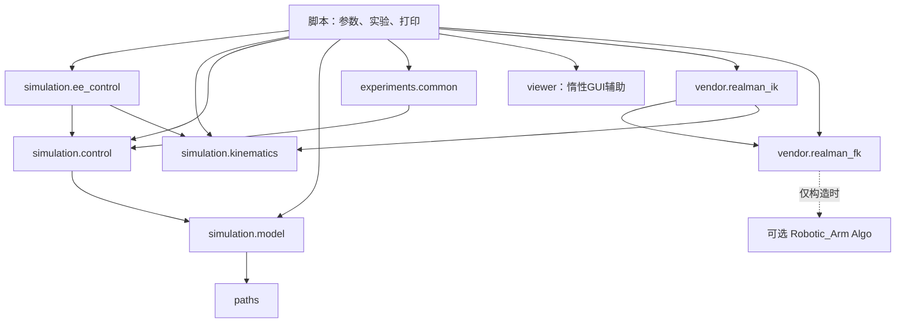

# 工程结构与调用约定（02-D）

本项目采用 src 布局：可复用能力通过安装后的 `realman_rl_simtoreal` 包调用；脚本负责命令行、实验流程及窗口展示。这样未来环境不必导入一个演示脚本来获得控制器，也不会顺带执行参数解析、打印或打开 Viewer。

本阶段只是迁移，没有修改模型、DLS、控制增益、限位、重力补偿、碰撞规则或厂家算法。本包版本为 0.1.0，和机器人模型/厂家算法版本没有对应关系。

## 目录

```text
realman_rl_simtoreal/
├── assets/robots/rml63/             # 原始及派生模型、mesh、来源、校验与许可证
├── src/realman_rl_simtoreal/
│   ├── __init__.py                  # 轻量包入口，无运行时初始化
│   ├── paths.py                     # editable 源码仓库中的资源/输出路径
│   ├── viewer.py                    # 惰性的 CLI Viewer 生命周期与后端辅助
│   ├── simulation/
│   │   ├── __init__.py
│   │   ├── model.py                 # 加载、模型检查、映射、初始化、纯重力诊断
│   │   ├── control.py               # 原有关节控制段与总驱动力审计
│   │   ├── ee_control.py            # 原有末端检查、碰撞预检、执行和误差
│   │   └── kinematics.py            # 原有 FK、Jacobian、DLS IK
│   ├── vendor/
│   │   ├── __init__.py
│   │   ├── realman_fk.py            # 可选离线 Algo FK
│   │   └── realman_ik.py            # 可选离线 Algo IK、全解与复核
│   └── experiments/
│       ├── __init__.py
│       └── common.py                # 共享姿态、SE(3)、默认序列、纯文本格式化
├── scripts/
│   ├── inspect_model.py
│   ├── view_robot.py
│   ├── build_dynamics_model.py
│   ├── control_joints.py
│   ├── control_ee.py
│   ├── compare_controllers.py
│   ├── compare_fk.py
│   └── compare_ik.py
├── tests/                          # 原75项及新增10项包/入口兼容测试
├── docs/
│   ├── architecture.md
│   └── validation/                 # 六份历史报告及本次重构验证
├── outputs/                        # Git忽略；实验和重构对照产物
├── pyproject.toml
├── requirements.txt
├── requirements-vendor.txt
├── README.md
└── .gitignore
```

## 迁移关系与职责

| 原位置 | 新位置/保留职责 |
|---|---|
| control_joints 的 load_model / initialize / 映射与结构检查 | simulation.model；函数签名和返回三元组不变 |
| compare_controllers 的 gravity_torque | simulation.model；独立 MjData、零速度 qfrc_bias |
| control_joints 的 validate_target / run_segment / 控制阈值 | simulation.control；插值、步进、限位、接触和统计原样保留 |
| compare_controllers 的 ForceMonitor | simulation.control；补偿和电机合成后限幅及被动力旁路审计 |
| scripts/kinematics.py | simulation.kinematics；整体迁移，不留副本 |
| control_ee 的 check_motion / execute_motion / 阈值 | simulation.ee_control；CLI、打印、Viewer 仍留在脚本 |
| scripts/realman_fk.py、realman_ik.py | vendor 同名模块；不留旧导入转发 |
| 默认13段关节实验、共同FK姿态、SE(3)及关节报告格式 | experiments.common；打印回调仍由脚本提供，保留 JSON 的 joint_sequence.log |
| view_robot 的 passive_viewer / 分散的后端选择 | viewer；只供脚本调用，按需导入 mujoco.viewer |

静态URDF检查与模型生成仍是独立工具，不合并进动力学控制器。生成器只改用统一资源路径，导出算法、参数和注释不变，输出必须与原MJCF逐字节一致。

`require` 在 model 中保留原 ValueError 行为，control 导入同一函数；没有增加新的验证规则。核心 `__init__.py` 不做便利性的大量重导出，也不实例化模型、Kinematics 或 Algo。

## 依赖与数据流



核心 simulation 模块不依赖 scripts、experiments、viewer 或 vendor。厂家 IK 沿用 MuJoCo 的四元数辅助和既有旋转误差函数，因此是 vendor 单向使用 simulation；不会由 MuJoCo 控制自动调用厂家 IK。

关节控制流程：`model.load_model → model.initialize → control.validate_target → control.run_segment → ctrl → mj_step → 原有数值/限位/接触检查 → 统计`。`step_observer` 在 mj_step 后、任何 tick 的 mj_forward 前调用，确保观察的是该物理步使用的合力矩。

末端控制流程：`Kinematics.solve_ik → ee_control.check_motion → 原有51点碰撞预检 → execute_motion → control.run_segment → 执行器运动 → 实际末端误差`。IK/FK 使用独立数据；正常运动不赋值实际 qpos。

厂家对照是另一条纯计算流程：`厂家FK目标 → 厂家IK → 厂家FK复核`。RealManIK 继承唯一的 RealManFK 实现，共用进程全局活跃会话保护；配置只能顺序使用。不能混用绕过适配器直接修改原生全局状态的SDK代码。失败仍是 q=None，不自动尝试其他求解器或发送执行器指令。

## 导入与未来环境

先在现有 realman_rl 环境完成 editable 安装。新代码使用：

```python
from realman_rl_simtoreal.simulation.model import load_model, initialize
from realman_rl_simtoreal.simulation.kinematics import Kinematics, IKResult
from realman_rl_simtoreal.simulation.control import validate_target, run_segment, ForceMonitor
from realman_rl_simtoreal.simulation.ee_control import check_motion, execute_motion

model, joint_ids, actuator_ids = load_model(gravity_compensation=False)
data = initialize(model)
kin = Kinematics(model)
```

旧的 `from kinematics ...` 或从 control_joints 导入核心函数不再是支持接口。八个原脚本路径、CLI 参数和退出码继续保留。测试核心时直接导入包；需要测试脚本实验函数时，用标准库 importlib 按文件加载，不修改 sys.path。生产代码不使用这种测试加载方式。

未来 Gymnasium 可从上述模块获取模型、运动学和关节控制能力，但本次没有创建环境。run_segment 仍是带统计和收敛检查的整段执行函数；±5°、10mm、固定home朝向等既有演示边界仍在，不能把它无条件视为未来环境的通用单步控制接口。单步接口、动作范围、reset/step策略和奖励设计属于后续任务。

## 安装与路径边界

pyproject 使用 setuptools 的 src 包发现；基础和 vendor 可选依赖分别动态读取两份原锁定文件。默认安装不要求 Robotic_Arm；任何包初始化都不强制导入它，只有厂家适配器构造时才尝试加载。

本次验证使用 `python -I -m pip install --no-build-isolation -e .`，复用环境中已有构建工具，不升级依赖。通常也可用标准 `python -I -m pip install -e .` 让pip管理构建隔离。无需 PYTHONPATH 或脚本内路径补丁；`-I` 下通过 Conda 环境 site-packages 中的 editable 注册定位源码。

paths 从自身文件位置定位仓库 assets/outputs，不按终端目录搜索。**只支持保留源码仓库的 editable 使用方式，不承诺普通wheel脱离仓库后的资源加载。** 搬移仓库后应重新 editable 安装。

Viewer 的 X11 默认选择在 CLI 导入 MuJoCo/GLFW 前执行，显式 PYGLFW_LIBRARY_VARIANT 优先。核心导入不选择GUI后端；Viewer打开、相机、同步循环和提前退出语义由各脚本保留，退出时继续等待本次Viewer线程清理。

## 单位与保留限制

| 数据 | 约定 |
|---|---|
| 包内关节角、ctrl、IK初值/解 | rad，joint_1..joint_6 顺序 |
| SDK原生关节角 | degree，由厂家适配器转换 |
| 位置、平移 | m；CLI delta-mm和报告mm字段显式转换 |
| 旋转矩阵 | 3×3主动旋转，末端向world/名义base；误差为SO(3)最短旋转向量/角 |
| SDK四元数 | 单位 wxyz；不使用欧拉角差作通用姿态误差 |
| 力矩、质量、惯量、时间 | N·m、kg、kg·m²、s；报告字段标注角度/速度单位 |

ee_site 仍是 link_6 原点，不是标定TCP。型号代际、传感器对应、原始惯量异常和模型差异继续保留。厂家IK边界失败及MuJoCo远初值失败没有被修复或隐藏。历史报告原文移动到 validation，历史代码路径描述当时的结构，当前入口以本文和README为准。
