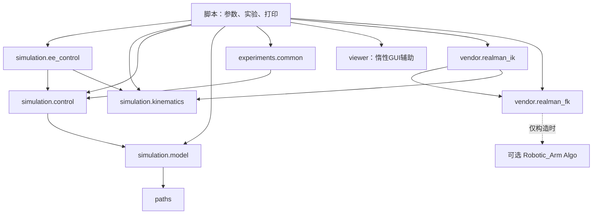

# 工程结构与调用约定（02-D、03-A/B任务、03-C1/C2夹爪）

本项目采用 src 布局：可复用能力通过安装后的 `realman_rl_simtoreal` 包调用；脚本负责命令行、实验流程及窗口展示。这样未来环境不必导入一个演示脚本来获得控制器，也不会顺带执行参数解析、打印或打开 Viewer。

02-D只是迁移。03-A在原接口旁增加固定周期推进及最小Gymnasium环境，没有修改模型、DLS、原控制增益、限位、重力补偿、碰撞规则或厂家算法。本包版本为0.1.0，和机器人模型/厂家算法版本没有对应关系。

## 目录

```text
realman_rl_simtoreal/
├── assets/robots/rml63/             # 原始及派生模型、mesh、来源、校验与许可证
├── assets/grippers/eg2_4c2/         # 官方EG2-4C2、独立模型与实验组合模型
├── assets/scenes/grasp_contact.xml  # 独立动态方块/支撑台实验，不改变原资源
├── src/realman_rl_simtoreal/
│   ├── __init__.py                  # 轻量包入口，无运行时初始化
│   ├── paths.py                     # editable 源码仓库中的资源/输出路径
│   ├── viewer.py                    # 惰性的 CLI Viewer 生命周期与后端辅助
│   ├── envs/
│   │   ├── __init__.py              # 轻量标识，不自动注册或创建环境
│   │   └── reach_env.py             # 固定/随机目标、三维动作、奖励、Gymnasium API
│   ├── simulation/
│   │   ├── __init__.py
│   │   ├── model.py                 # 加载、模型检查、映射、初始化、纯重力诊断
│   │   ├── control.py               # 原控制段/力审计及新增固定周期推进
│   │   ├── gripper.py               # 米制宽度、mimic约束、独立执行器与物理推进
│   │   ├── grasp_contact.py         # 独立实验的接触分类、力记录及载荷配置
│   │   ├── ee_control.py            # 原有末端检查、碰撞预检、执行和误差
│   │   └── kinematics.py            # 原有 FK、Jacobian、DLS IK
│   ├── vendor/
│   │   ├── __init__.py
│   │   ├── realman_fk.py            # 可选离线 Algo FK
│   │   └── realman_ik.py            # 可选离线 Algo IK、全解与复核
│   └── experiments/
│       ├── __init__.py
│       └── common.py                # 共享姿态、SE(3)、默认序列、纯文本格式化
├── scripts/
│   ├── inspect_model.py
│   ├── view_robot.py
│   ├── build_dynamics_model.py
│   ├── control_joints.py
│   ├── control_ee.py
│   ├── compare_controllers.py
│   ├── compare_fk.py
│   ├── compare_ik.py
│   ├── smoke_reach_env.py           # 无界面固定目标演示
│   ├── evaluate_reach_baselines.py  # 随机/规则策略、奖励反例及独立性能剖析
│   ├── build_gripper_model.py       # 校验并生成独立/组合模型
│   ├── demo_gripper.py              # 空载开合、带载保持与Viewer
│   ├── build_grasp_scene.py         # 从原齿面生成代理和动态方块场景
│   └── test_grasp_contact.py        # 接触、抬升、释放及失败对照/Viewer
├── tests/                          # 原153项及新增24项接触/同步控制测试
├── docs/
│   ├── architecture.md
│   └── validation/                 # 历史实验、重构及环境验证
├── outputs/                        # Git忽略；实验和重构对照产物
├── pyproject.toml
├── requirements.txt
├── requirements-vendor.txt
├── README.md
└── .gitignore
```

## 迁移关系与职责

| 原位置 | 新位置/保留职责 |
|---|---|
| control_joints 的 load_model / initialize / 映射与结构检查 | simulation.model；函数签名和返回三元组不变 |
| compare_controllers 的 gravity_torque | simulation.model；独立 MjData、零速度 qfrc_bias |
| control_joints 的 validate_target / run_segment / 控制阈值 | simulation.control；插值、步进、限位、接触和统计原样保留 |
| compare_controllers 的 ForceMonitor | simulation.control；补偿和电机合成后限幅及被动力旁路审计 |
| scripts/kinematics.py | simulation.kinematics；整体迁移，不留副本 |
| control_ee 的 check_motion / execute_motion / 阈值 | simulation.ee_control；CLI、打印、Viewer 仍留在脚本 |
| scripts/realman_fk.py、realman_ik.py | vendor 同名模块；不留旧导入转发 |
| 默认13段关节实验、共同FK姿态、SE(3)及关节报告格式 | experiments.common；打印回调仍由脚本提供，保留 JSON 的 joint_sequence.log |
| view_robot 的 passive_viewer / 分散的后端选择 | viewer；只供脚本调用，按需导入 mujoco.viewer |

静态URDF检查与模型生成仍是独立工具，不合并进动力学控制器。生成器只改用统一资源路径，导出算法、参数和注释不变，输出必须与原MJCF逐字节一致。

`require` 在 model 中保留原 ValueError 行为，control 导入同一函数；没有增加新的验证规则。核心 `__init__.py` 不做便利性的大量重导出，也不实例化模型、Kinematics 或 Algo。

## 依赖与数据流



核心 simulation 模块不依赖 scripts、experiments、viewer 或 vendor。厂家 IK 沿用 MuJoCo 的四元数辅助和既有旋转误差函数，因此是 vendor 单向使用 simulation；不会由 MuJoCo 控制自动调用厂家 IK。

关节控制流程：`model.load_model → model.initialize → control.validate_target → control.run_segment → ctrl → mj_step → 原有数值/限位/接触检查 → 统计`。`step_observer` 在 mj_step 后、任何 tick 的 mj_forward 前调用，确保观察的是该物理步使用的合力矩。

末端控制流程：`Kinematics.solve_ik → ee_control.check_motion → 原有51点碰撞预检 → execute_motion → control.run_segment → 执行器运动 → 实际末端误差`。IK/FK 使用独立数据；正常运动不赋值实际 qpos。

厂家对照是另一条纯计算流程：`厂家FK目标 → 厂家IK → 厂家FK复核`。RealManIK 继承唯一的 RealManFK 实现，共用进程全局活跃会话保护；配置只能顺序使用。不能混用绕过适配器直接修改原生全局状态的SDK代码。失败仍是 q=None，不自动尝试其他求解器或发送执行器指令。

## 导入与未来环境

先在现有 realman_rl 环境完成 editable 安装。新代码使用：

```python
from realman_rl_simtoreal.simulation.model import load_model, initialize
from realman_rl_simtoreal.simulation.kinematics import Kinematics, IKResult
from realman_rl_simtoreal.simulation.control import validate_target, run_segment, ForceMonitor
from realman_rl_simtoreal.simulation.ee_control import check_motion, execute_motion

model, joint_ids, actuator_ids = load_model(gravity_compensation=False)
data = initialize(model)
kin = Kinematics(model)
```

旧的 `from kinematics ...` 或从 control_joints 导入核心函数不再是支持接口。八个原脚本路径、CLI 参数和退出码继续保留。测试核心时直接导入包；需要测试脚本实验函数时，用标准库 importlib 按文件加载，不修改 sys.path。生产代码不使用这种测试加载方式。

03-A的 `envs.reach_env.ReachEnv` 直接从上述模块获取模型、运动学、目标验证和碰撞预检，不依赖脚本、vendor、experiments或Viewer。`run_segment`仍保留原有统计和收敛检查；环境改用新增的 `control.advance_control_cycle`，不会在step内等待稳态或调用旧演示序列。±5°、10mm和固定home目标朝向等局部实验边界继续保留。

环境数据流：归一化世界XYZ动作 → 独立命令位置 → 以最近合法关节命令为初值的原DLS IK → 限位/位姿复核及51点碰撞预检 → 指令变化率限制与平滑 → 固定物理步 → 总力矩/数值/速度/碰撞审计 → 新状态下的观测和奖励。正常step不写实际qpos；reset通过官方keyframe重置状态。每个物理步先审计驱动力，再刷新运动学缓存，顺序与原控制要求相同。

环境支持 `reset(seed=..., options=None)`、`step`、Dict观测、`compute_reward`、文本 `render` 及幂等 `close`。当前不自动注册Gymnasium ID，直接导入类实例化；没有复杂插件框架或训练器。完整形状、失败语义和控制参数见 [03-A验证](validation/REACH_ENV_VALIDATION.md)。

03-B仅扩展envs与实验脚本，没有修改simulation核心或vendor。`target_mode="fixed"`和原米制`distance`奖励继续兼容；`target_mode="random"`在reset中通过np_random采样候选，用原IK、限位和路径预检接受目标，最多尝试64次，失败关闭当前episode并报错。默认候选球壳为home周围3–5mm；实际分布是通过检查后的条件分布，不代表完整工作空间。

随机模式默认`safe_dense`奖励：归一化截断距离成本加独立的安全失败惩罚；step把含`is_safety_failure`的info传给compute_reward。可标量或批量重算，不读取原目标的成功标记。固定目标也可显式选safe_dense用于训练实验。命令边界仍终止，模型及物理安全阈值不变。

规则策略留在评估脚本，只读取27维观测中的位置/目标/命令参考，经env.step驱动；不访问真实关节状态或调用IK绕过环境。评估与独立cProfile记录属于实验层，不向环境info加入非确定性的墙钟计时。任务分布、奖励推导、性能以及未来HER需要重算的字段见 [03-B验证](validation/REACH_TASK_VALIDATION.md)。

## 安装与路径边界

03-C1保持ReachEnv默认6轴场景不变，新增独立资源路径GRIPPER_SCENE。model.load_model按六个命名hinge和执行器建立映射，允许附件坐标；initialize仍使用模型home keyframe。编译前重力补偿遍历link_1后代（包括新载荷），只路由机器人joint，不影响无关场景body。Kinematics仍接收/返回六个机械臂角，Jacobian按六个dof列切片，使用独立MjData；碰撞预检保留输入数据中的附件qpos。没有把夹爪关节加入Reach动作。

Gripper校验6个夹爪hinge、5条激活mimic和一个eg2_position，set_width/open/close只选目标，step只改该执行器ctrl并推进共享物理。实际开口由独立数据中的pad sites读取，不改实时状态/力缓存。机械臂控制仍只写原6个ctrl；两种独立推进函数各自都会过物理时间；03-C2新增的同步周期见下文，仍不新增Pick或完整控制抽象。

ee_site是原link_6原点；实验gripper_mount位于其+Z8mm；grasp_site是mount+Z147.530235mm的固定名义参考，真实指垫中心随开口运动。该装配与真实六维力/相机板栈、TCP和传动动力学尚未校准。转换、接触和限制见 [03-C1验证](validation/GRIPPER_VALIDATION.md)。

pyproject 使用 setuptools 的 src 包发现；基础和 vendor 可选依赖分别动态读取两份原锁定文件。默认安装不要求 Robotic_Arm；任何包初始化都不强制导入它，只有厂家适配器构造时才尝试加载。

本次验证使用 `python -I -m pip install --no-build-isolation -e .`，复用环境中已有构建工具，不升级依赖。通常也可用标准 `python -I -m pip install -e .` 让pip管理构建隔离。无需 PYTHONPATH 或脚本内路径补丁；`-I` 下通过 Conda 环境 site-packages 中的 editable 注册定位源码。

paths 从自身文件位置定位仓库 assets/outputs，不按终端目录搜索。**只支持保留源码仓库的 editable 使用方式，不承诺普通wheel脱离仓库后的资源加载。** 搬移仓库后应重新 editable 安装。

Viewer 的 X11 默认选择在 CLI 导入 MuJoCo/GLFW 前执行，显式 PYGLFW_LIBRARY_VARIANT 优先。核心导入不选择GUI后端；Viewer打开、相机、同步循环和提前退出语义由各脚本保留，退出时继续等待本次Viewer线程清理。

## 单位与保留限制

| 数据 | 约定 |
|---|---|
| 包内关节角、ctrl、IK初值/解 | rad，joint_1..joint_6 顺序 |
| SDK原生关节角 | degree，由厂家适配器转换 |
| 位置、平移 | m；CLI delta-mm和报告mm字段显式转换 |
| 旋转矩阵 | 3×3主动旋转，末端向world/名义base；误差为SO(3)最短旋转向量/角 |
| SDK四元数 | 单位 wxyz；不使用欧拉角差作通用姿态误差 |
| 力矩、质量、惯量、时间 | N·m、kg、kg·m²、s；报告字段标注角度/速度单位 |

ee_site 仍是 link_6 原点，不是标定TCP。型号代际、传感器对应、原始惯量异常和模型差异继续保留。厂家IK边界失败及MuJoCo远初值失败没有被修复或隐藏。历史报告原文移动到 validation，历史代码路径描述当时的结构，当前入口以本文和README为准。


## 03-C2 接触实验与同步物理周期

`paths.GRASP_CONTACT_SCENE`只供独立接触实验使用。原ReachEnv、GRIPPER_SCENE及厂家模块保持原模型和接口。新增freejoint的7个qpos/6个qvel不能被六轴控制覆盖；模型加载/补偿仍按命名关节和link_1子树识别机器人，目标物体不在补偿子树。

`Gripper.update_control()`只更新夹爪ctrl，`observe_step()`只审计刚完成的物理步；原`Gripper.step()`组合两者继续独立运行。`control.advance_synchronized_cycle(m,d,jids,aids,target,gripper,physics_steps=25)`验证共享model/data、原映射、±5°目标与每周期0.5°指令变化上限。循环顺序为：平滑更新六轴ctrl → 更新夹爪ctrl（原0.5rad/s上限）→ **一次mj_step** → 原ForceMonitor及夹爪总驱动力/状态审计 → 可选接触记录器 → mj_forward → 再次状态检查。没有live qpos赋值，没有多跑一个夹爪积分周期。

`Gripper(contact_policy=None)`保留空载默认0.1mm碰撞阈值。独立场景显式传入`grasp_contact.ContactPolicy`，只对按geom/body识别的目标—左右指垫、目标—支撑台设置各自允许数值穿透；其余接触保持原阈值。机械臂/夹爪限位、速度、mimic、总驱动力及外力注入检查均保留。夹爪五个无伺服从动joint也检查补偿路由和总驱动力限幅。

`ContactRecorder`在刷新实时力缓存前调用mj_contactForce，每2ms记录标量，20Hz及新接触类别首次出现时保存接触位置/坐标系力/世界系物体受力。姿态及当前指垫位置使用独立MjData；几何凹槽反例也只是独立初始化的forward诊断。该模块不导入脚本、厂家SDK或环境。

实验脚本负责时序与Viewer：稳定→6秒慢闭合→台面保持→沿支撑法向5mm抬升→2秒离台保持；释放案例先降到名义1mm高度再慢开。运动仍由现有执行器产生。所有案例、负对照和失败原因详见validation/GRASP_CONTACT_VALIDATION.md，未引入抓取环境或训练逻辑。
