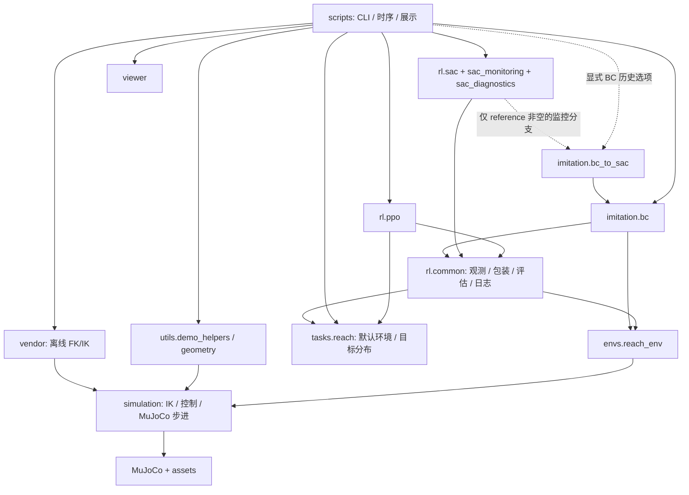

# 工程架构与调用约定

本项目采用 src + editable 布局。脚本组织命令行、训练时序和展示；可复用实现位于 `realman_rl_simtoreal` 包。当前目录重构不改变 MuJoCo 资源、控制、ReachEnv、算法及超参数。逐文件说明见 [FILE_MAP](FILE_MAP.md)，完整迁移和实测结果见 [重构报告](validation/PROJECT_ORGANIZATION_REFACTOR.md)。

## 目录

```text
realman_rl_simtoreal/
├── assets/{robots,grippers,scenes}/
├── src/realman_rl_simtoreal/
│   ├── __init__.py
│   ├── paths.py
│   ├── viewer.py
│   ├── simulation/{model,kinematics,control,ee_control,gripper,grasp_contact}.py
│   ├── envs/reach_env.py
│   ├── tasks/reach.py
│   ├── rl/
│   │   ├── common/{observation,env_factory,evaluation,metrics,baselines,artifacts}.py
│   │   ├── ppo.py
│   │   ├── sac.py
│   │   ├── sac_monitoring.py
│   │   └── sac_diagnostics.py
│   ├── imitation/{bc,bc_to_sac}.py
│   ├── utils/{geometry,demo_helpers}.py
│   └── vendor/{realman_fk,realman_ik}.py
├── scripts/{train,evaluate,demos,models,diagnostics,plots}/
├── tests/fixtures/reach_terminate_04a.json
├── tests/test_*.py
├── docs/{architecture.md,FILE_MAP.md,experiments/,validation/}
├── outputs/
├── pyproject.toml
├── requirements{,-rl,-vendor}.txt
└── README.md
```

所有包目录具有轻量 `__init__.py`，不实例化模型、环境、SDK 或学习器。脚本目录不作为包，不需要额外 `__init__.py`。正式入口已迁移，不保留旧脚本副本或 `experiments.*` 转发层。

## 层次与依赖方向



- `simulation/` 不依赖算法、任务、演示、Viewer 或 SDK，资源通过 `paths.py` 定位。`envs/` 单向依赖仿真，不导入 PPO、SAC、BC。
- `tasks/reach.py` 保存原 `ENV_CONFIG`、`TASKS` 和 `task_environment()`；不导入算法或统计模块。固定 +X5mm、easy 随机 2–3mm、原随机 3–5mm 条件可达目标分布不变。
- `rl/common/` 不导入本项目 PPO/SAC/BC 实现；PPO 与 SAC 不相互依赖。`env_factory` 使用 SB3 的 Monitor/VecEnv，其他模块按具体职责使用 Gymnasium、NumPy 或 PyTorch。
- `imitation/bc.py` 只复用公共观测、规则基线和产物工具，不导入 SAC。`bc_to_sac.py` 保留 Actor 均值通路的严格兼容校验与复制；普通训练不会导入它。
- `sac_monitoring` 保留有条件的 `bc_to_sac.action_deviation` 惰性导入，以兼容明确指定 BC 参照的历史实验。公共 `evaluate()` 接受可选 `reference_policy` 对象，但不导入或构造 BC。
- 测试按文件加载脚本以检验入口行为；生产包不导入脚本，不修改 `sys.path`。

## 公共功能归属

`observation.py` 保存 `ReachTransform`、`ScaledReachObservation` 以及公共 `FEATURE_KEYS` / `features()`；`env_factory.py` 构造训练包装栈和只读 reset 探针。`evaluation.py` 共享确定性评估协议、Episode 汇总和原 TensorBoard 指标写入；`metrics.py` 保存只读 `MotionStats`；`baselines.py` 提供原规则策略；`artifacts.py` 提供 JSON、版本、资产指纹及原空目录检查。

SAC 的 `TrainingAudit` 与 `MonitoredTrainingAudit` 在 `sac_monitoring.py`，Q 与 soft TD 诊断集中于 `sac_diagnostics.py`；`sac.py` 只保留 SAC 参数、官方模型创建及模型 / Replay checkpoint 格式。PPO 的 Rollout、动作裁剪、优化计数、checkpoint 和参数不变性审计仍在 `ppo.py`。

SE(3) 矩阵工具位于 `utils/geometry.py`，共享 FK 姿态、关节演示序列与报告格式位于 `utils/demo_helpers.py`。这些功能不放在 RL 公共模块中，避免基础控制演示依赖训练框架。

## 观测、动作和奖励契约

默认 `observation_mode="legacy"` 的原始 Dict 保持 `observation(27)`、`achieved_goal(3)`、`desired_goal(3)`。27维依次为：q(6)、qvel(6)、实际末端(3)、目标减实际(3)、命令位置(3)、实际ctrl(6)。原始观测为float64，位置单位为米，角度为弧度。

schema 2 固定仿射变换只缩放 27 维 observation，沿用 home 中心、5°、30°/s、10mm 尺度并转为 float32；两个 goal 键仍为 float64 米制，偏移为 0、缩放为 1。网络使用 `achieved_goal → desired_goal → observation` 的 33 维 float32 拼接，保持 SB3 CombinedExtractor 与 BC 的输入顺序一致。不增加 clipping、在线归一化或奖励归一化。

PPO可显式选择 `observation_mode="fetch_like_v1"`：普通observation仅包含ee_site实际世界位置(3)和
`mj_jacSite`完整位置Jacobian乘qvel、再乘control_period的运动特征(3)，加两个3维goal共12维。
运动特征单位为米。schema=3固定变换将位置相对home、运动特征按0.01m缩放；两个goal仍为世界坐标米。
官方MultiInputPolicy/CombinedExtractor将完整Dict的12维传给Actor和Critic，无自定义筛选或额外相对位置拼接。
规则策略、BC与SAC专用实验/诊断当前只支持legacy，遇到新模式明确拒绝；运动统计从已有info读取命令位置。

包装顺序从内向外严格为：

```text
ReachEnv → ScaledReachObservation → Monitor → DummyVecEnv → VecCheckNan
```

包装器的 `compute_reward` 仍向原环境传入米制 goal。PPO 按官方实现将原始高斯动作裁剪到动作 Box 后交给环境，RolloutBuffer 与 log_prob 仍使用原始动作；SAC 保留官方压缩动作及 Replay 语义。所有奖励、失败、拒绝与 timeout 逻辑都留在原 `reach_env.py`。

奖励保留distance、safe_dense和reach_shaped_v1，并可显式选择reach_progress_v1。
新奖励使用真实previous_achieved_goal与当前achieved_goal相对传入desired_goal的距离差，
加持续距离成本、每步成本、成功奖金及真实安全/拒绝成本；不使用命令位移或历史成功标记。
`tasks/rewards.py`集中默认参数和校验；GoalEnv接口支持标量/批量与目标重标记，
`reward_components()`为纯查询，info和现有训练/评估JSON记录六个signed分项及距离元数据，不进入观测。
新checkpoint在环境配置、顶层reward_parameters及SB3普通metadata中保存/核对完整参数；旧checkpoint继续加载。
PPO更新、目标分布和控制/安全逻辑不变。诊断先于新实现完成，旧公式无明确错误；
典型安全排序、往返折扣边界及339项验证见[奖励报告](validation/REACH_REWARD_OPTIMIZATION_VALIDATION.md)。

## PPO 训练数据流

1. `scripts/train/train_ppo_reach.py` 解析任务与观测模式，用 `tasks.reach` 的配置构造独立训练环境，保存环境、对应schema=2/3变换、模式/空间/字段顺序/实际特征维度、依赖和资源指纹。
2. `rl.ppo.make_ppo` 创建官方 `PPO("MultiInputPolicy")`，保留独立 256×256/Tanh 策略和价值网络及原超参数。
3. SB3 从包装后的 Dict 预测动作；经原动作 Box 裁剪和 `env.step` 形成真实轨迹。PPOAudit 只读记录原始 / 实际动作、运动、安全与训练 Episode，不产生动作或修改奖励。
4. SB3 采集完整 512 步 Rollout，计算原优势和 log_prob，按 64 样本 minibatch 完成 10 个 epoch。timeout bootstrap 与优化器逻辑完全使用官方实现。
5. `learn` 返回后读取优化指标，在跨越配置阈值的完整更新点执行评估和 checkpoint；保留第 0 步、最终步、部分更新中断的原标记。
6. `evaluate_ppo` 使用独立环境和保存的预处理，确定性推理并核验参数 / 优化计数不变；`record_evaluation` 写原有 JSON / TensorBoard 指标，绘图脚本只读取这些已测量数据。

04-F2直接复用上述流程及`tasks.reach`现有`random_reach`，不增加物理环境或训练器。正式训练只需显式选择随机任务及20个评估目标。PPO评估结果额外保存每个Episode的`raw_actions`、`actual_positions_before_m`和`box_clipping`；原`actions`仍为真正输入环境的Box裁剪动作。记录只读，不改变分布、动作、奖励、网络、Rollout或更新顺序。

04-F3在`tasks.reach`增加`axis_pair_reach`和`axis_six_reach`两个显式候选配置。ReachEnv增加`target_mode="discrete"`及米制`target_offsets`；构造时检查全部候选的原IK、home±5°、姿态与路径碰撞条件，任何一个失败都报告并拒绝整个任务，不删除或缩短目标。reset随机选候选，正常step不变。`options={"goal_index": i}`仅供合法reset选目标；`goal_index`只在info中，不进入33维网络观测。候选数组及预检报告通过副本提供，不能用它们修改命令或实际状态。

目前±X5mm合法；六方向5mm中±Y的当前DLS候选解违反原home±5°范围，默认六方向配置会拒绝启动。显式3mm六方向只用于离线诊断，不是暗中改变训练阶段。`scripts/diagnostics/probe_ppo_goals.py`从合法reset获取同一物理状态的观测，检查冻结Actor对目标特征的响应，不执行step或修改权重。旧`probe_reach_env.py`继续只检查原固定/球壳任务。

公共evaluation对离散任务逐一枚举候选，强制Episode数等于不同目标数；不依赖随机seed碰巧覆盖目标。保存`per_goal`、每个Episode的运动统计及结束详情，PPO继续补充raw/applied和实际位置。训练/独立评估CLI对离散任务自动选择全部候选数，显式错误数量报错；旧模式默认1集不变。TensorBoard使用`evaluation/goals/plus_x|minus_x/...`等逐目标标签，原聚合指标保留；绘图从实际per_goal JSON增加成功、距离、首动作XYZ、随机训练成功率和终止分类，不用重复次数伪称泛化。课程阶段仍只支持scratch，未实现PPO权重迁移或跨进程续训。参见[04-F3验证](validation/PPO_GOAL_CONDITIONED_VALIDATION.md)。

`scripts/evaluate/analyze_reach_results.py`只读取评估JSON，按相对reset home的XYZ符号（六组可重叠）、八象限及3–4/4–5mm半径分组，保留空组、小样本和范围外目标计数。它还比较原始/实际动作方向、裁剪角度及+X偏置；缺少原始轨迹的历史文件明确标记不可计算，不反推数据或重新调用IK。该入口仅依赖NumPy/标准库，不加载SDK、模型或环境。原有公共指标名称保留，不创建语义相同的TensorBoard标签。准备检查、种子划分和手动命令见[随机Reach验证](validation/PPO_RANDOM_REACH_VALIDATION.md)。

SAC 同样共享包装、独立评估和日志，保留官方 DictReplayBuffer、损失、采样 RNG 与熵系数。不同算法的更新调度和算法专属 checkpoint 状态分别保留，不强行抽象为一个训练器。

## Gymnasium 与 MuJoCo

```text
归一化世界 XYZ 增量动作
  → ReachEnv 独立命令参考
  → 原 DLS IK / 限位 / 位姿 / 51 点路径碰撞预检
  → 原关节命令变化率限制与插值
  → simulation.control.advance_control_cycle
  → ctrl + mj_step（正常周期 25 × 2ms = 50ms）
  → 实际状态观测、奖励、terminated / truncated
```

正常 step 不写实际 qpos；reset 使用官方 home keyframe。每个物理步继续审计原总驱动力、有限数值、速度、限位与碰撞。模型加载、重力补偿、FK/IK、夹爪和接触代码未改变。`ee_site` 仍是 link_6 原点，不是已标定 TCP。

## 训练、评估、诊断与测试

训练更新网络并写新 run；每次 CLI 从头创建模型，不是跨进程完整续训。评估固定模型、使用独立目标种子和保存的环境，不更新网络或 Replay。诊断只读分析 Q/TD/轨迹；边界对照脚本仅在原明确训练模式中启动新的 SAC 进程，`--final` 模式只评估。环境 `probe_reach_env.py` 不创建学习器。

测试位于 `tests/`，模型构建器由逐字节重生成测试覆盖；原23个argparse入口及新增只读分析入口在`/tmp`下通过绝对路径检查`--help`。测试含小规模训练更新与保存 / 加载，不以短测试成功率作为算法效果要求。PPO 测试阻断本项目 SAC、BC 与 SDK 导入，纯 SAC 测试阻断 BC / SDK 和专家动作。随机目标测试覆盖200个目标的原可达性/安全预检、reset/home与Episode内目标稳定、33维方向特征、分组分析及一次完整512步随机任务更新；固定任务的原PPO产物可显式复用，避免重复训练。

## 保存兼容性与边界

PPO/SAC 保存官方 SB3 类和参数，配置以 JSON 保存；Replay 使用官方序列化并 gzip 压缩。BC 保存显式网络标识、配置和 state_dict，继续 `torch.load(weights_only=True)`。现有有效模型未引用旧业务类路径，无需兼容包装。仅使用仓库已有、来源明确的本地模型做只读验证，不下载或加载未知文件。

新PPO配置schema=2保存观测元数据；历史PPO配置schema=1、变换schema=2仍按legacy加载。
加载核对保存模式、固定变换、模型空间与实际features_dim，33/12维模型不得混用或自动迁移权重。
314项双模式开发验收及用户完成的12维随机Reach两档预算结果（16384步、131072步）见[Fetch观测验证报告](validation/REACH_FETCH_OBSERVATION_VALIDATION.md)。

早期 schema 1 SAC smoke 配置以及缺少相邻 config.json 的历史文件在基线已不可通过当前加载协议评估；本次不改变原拒绝行为、不猜测配置。完整数量和路径见重构报告。

`pyproject.toml` 原 `include = ["realman_rl_simtoreal*"]` 自动发现新包；安装元数据、依赖版本及 editable 导入在隔离进程验证。未重新安装、升级依赖，也未修改 PYTHONPATH。普通 wheel 的资源打包仍未实现。

模型生成器 `build_dynamics_model.py` 保留写入 MJCF 的旧 provenance 注释字符串，保证资源重生成逐字节相同；它不是可执行路径，当前调用入口是 `scripts/models/build_dynamics_model.py`。

`assets/**/SOURCE.md` 同样作为原版本的来源记录保留，包含历史生成路径；不改写资源目录以保持已有资产指纹。当前三个生成命令见 README，路径对应关系见重构报告。

## 后续扩展

夹取抬升任务已经由 `envs/grasp_lift_env.py`、`tasks/grasp_lift.py`、`simulation/grasp_controller.py` 和 `rl/grasp_lift.py` 实现，入口为 `scripts/demos/run_grasp_lift.py`。环境提供 41 维 Box 观测、XYZ 加绝对夹爪开口的 4 维动作，通过 `advance_synchronized_cycle` 让机械臂、夹爪和自由物体共享每步 50 次 1 ms 积分。阶段控制器只产生这个动作空间中的动作，使用双侧接触后的有界横向对中反馈；物体的运动由接触、摩擦和重力产生。

成功计时在 1 ms 物理步后读取实际接触力和物体运动，要求持续离台、双侧夹持、低速度及有限滑移。`ContactRecorder` 可选择仅保留最近采样或保存完整物理历史，读取力缓存后才刷新实时几何；数值失败返回明确标记的最近有效观测。抓取评估保存在独立的 `outputs/grasp_lift/`，`rl/common` 的观测变换和训练记录仍服务于 Reach。视觉观测及真机适配需要独立验证，尚未实现。

旧版细节完整保存在 [历史架构快照](experiments/ARCHITECTURE_BEFORE_REFACTOR.md)；历史验证报告中的旧路径对应其原版本。现行命令以 README 和 FILE_MAP 为准。
