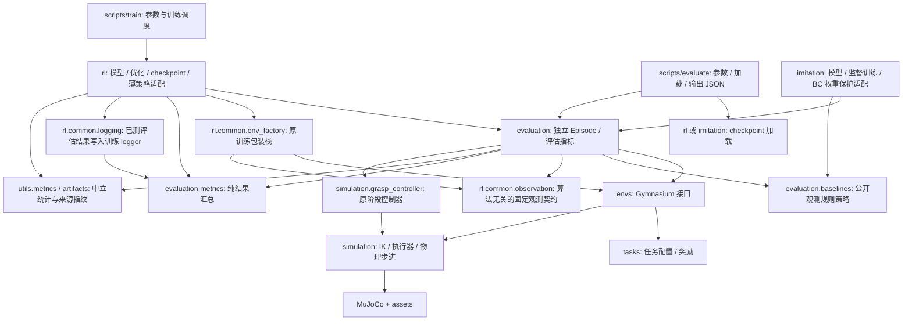

# 工程架构与调用约定

本项目采用 src + editable 布局。脚本组织命令行、训练时序和展示；可复用实现位于 `realman_rl_simtoreal` 包。当前目录重构不改变 MuJoCo 资源、控制、ReachEnv、算法及超参数。逐文件说明见 [FILE_MAP](FILE_MAP.md)，完整迁移和实测结果见 [重构报告](validation/PROJECT_ORGANIZATION_REFACTOR.md)。

## 目录

```text
realman_rl_simtoreal/
├── assets/{robots,grippers,scenes}/
├── src/realman_rl_simtoreal/
│   ├── __init__.py, paths.py, viewer.py
│   ├── simulation/{model,kinematics,control,ee_control,gripper,grasp_contact,grasp_controller}.py
│   ├── envs/{factory,reach_env,sequence_reach_env,grasp_lift_env}.py
│   ├── tasks/{reach,grasp_lift,rewards}.py
│   ├── rl/
│   │   ├── common/{observation,env_factory,artifacts,logging}.py
│   │   ├── ppo.py
│   │   ├── sac.py
│   │   ├── ppo_grasp.py
│   │   ├── sac_monitoring.py
│   │   └── sac_diagnostics.py
│   ├── evaluation/{__init__,reach,grasp_lift,metrics,baselines}.py
│   ├── imitation/{bc,bc_to_sac}.py
│   ├── utils/{geometry,demo_helpers,metrics,artifacts}.py
│   └── vendor/{realman_fk,realman_ik}.py
├── scripts/{train,evaluate,demos,models,diagnostics,plots}/
├── tests/{fixtures/,test_*.py}
├── docs/{architecture.md,FILE_MAP.md,OUTPUTS.md,experiments/,validation/}
├── outputs/{simulation,reach,grasp,imitation,validation}/
├── pyproject.toml
├── requirements{,-rl,-vendor}.txt
└── README.md
```

所有包目录具有轻量 `__init__.py`，不实例化模型、环境、SDK 或学习器。脚本目录不作为包，不需要额外 `__init__.py`。正式入口已迁移，不保留旧脚本副本或 `experiments.*` 转发层。

实验产物统一从 [输出导航](../outputs/README.md) 查找；分类和路径对照见 [OUTPUTS](OUTPUTS.md)。训练 run 内的模型、配置、评估、TensorBoard 和课程来源记录一起保留。outputs 根目录只保留五个分类目录与 README；机器索引、旧路径映射和迁移审计集中在 `validation/output_organization/`，日常使用五类正式路径。

## 层次与依赖方向



`simulation/`、`envs/`、`tasks/` 不导入评估或算法。`evaluation/` 不导入 PPO、SAC、BC 模块或训练入口，也不导入 PyTorch / SB3；策略由调用者传入。仅共享 `rl/common/observation.py` 的固定观测契约，这个模块本身不导入算法或学习框架。无需为了目录归属再复制一份缩放逻辑。

`rl/` 负责模型创建、训练、优化状态和 checkpoint。`evaluate_ppo` / `evaluate_model` 是保留的算法薄适配：选择确定性预测、编码观测、核对原始动作与 Box 裁剪、保护参数 / 训练计数，然后调用 Evaluation 执行 Episode；它们不创建第二套环境步进循环。SAC 直接用共享 Reach 协议。BC 的薄适配只提供权重指纹检查，训练与示范采集继续在 imitation。

`utils/metrics.py` 保存训练与评估都使用的 `MotionStats` 及余弦辅助，只有 NumPy 依赖；没有让训练基础设施反向依赖 Reach 或 GraspLift 的执行器。`utils/artifacts.py` 的 `experiment_metadata()` 为训练、评估和演示共享资源 / 源码指纹，避免来源记录依赖一个评估实现。

`sac_monitoring` 保留显式 BC 参照的惰性分支；普通纯 RL 不导入 imitation。核心包不导入 scripts，不修改 sys.path。所有包初始化保持轻量，新 Evaluation 包的 `__init__.py` 不加载环境或算法。

## 评估实现与入口

- `evaluation/reach.py`：原独立 Reach 评估、指定 seed / 离散目标枚举、连续多目标记录；通用 `evaluate_policy()` 接收原始观测到动作的 callable；`evaluate_bc()` 保留 BC 的逐步 records 协议。
- `evaluation/grasp_lift.py`：原 GraspLift `rollout()` / `evaluate()`。`model=None` 使用阶段控制器；传入具有 `predict(obs, deterministic=True)` 的对象即使用其动作。
- `evaluation/metrics.py`：原 Reach、GraspLift、BC、早期基线的汇总函数，保留各自字段与分母；不依赖环境、训练器或神经网络。
- `evaluation/baselines.py`：原 rule_action、早期随机 / 规则对照、奖励反例和独立 cProfile；BC 数据采集继续调用同一份规则策略。
- `rl/common/logging.py`：原 `record_evaluation()` 及完全相同的 TensorBoard 标签；只消费已有评估结果，不执行 Episode。

`scripts/evaluate/` 保留 CLI 参数、checkpoint 选择和加载、最终 JSON 与控制台输出。基线脚本的执行循环已迁入 Evaluation，脚本直接导入原函数名供测试调用。`analyze_reach_results.py` 是单个调用者的离线 JSON 分析，保留在脚本中。

历史 Reach RL、早期基线、BC 的 JSON 格式并不相同：BC 保存完整逐步 records 与方向分母，早期基线包含 warm-up / 力矩 / 延迟，现代 Reach 支持离散与连续目标。它们共处 Evaluation，但保留原协议，避免把运动方向阈值、结束原因键或成功率分母改成另一套定义。

### Reach 接口

已有 PPO 使用算法薄适配，checkpoint 仍由 RL 加载：

```python
from realman_rl_simtoreal.rl.ppo import load_ppo, evaluate_ppo

model, transform, saved = load_ppo(model_path)
result = evaluate_ppo(model, transform, saved['environment'], [88000])
```

新策略可直接用算法无关的接口。以 BC 为例，它的 predict 已经接收原始观测：

```python
from realman_rl_simtoreal.evaluation.reach import evaluate_policy
from realman_rl_simtoreal.imitation.bc import load_policy, weight_digest

policy, saved = load_policy(bc_path)
result = evaluate_policy(policy.predict, [88100], name='bc',
    config=saved['environment'], transform=policy.transform,
    state_digest=lambda: weight_digest(policy.network))
```

`predict_action(raw_obs)` 返回原动作空间允许的数组。SB3 策略的调用者应编码观测并选择 `predict(..., deterministic=True)[0]`。可选 `state_digest` 在评估前后核对权重 / 计数；它由调用者提供，不要求 Evaluation 导入算法。若需要历史 BC JSON，继续用 `imitation.bc.evaluate_policy` 的薄适配，或传指纹回调给 `evaluation.reach.evaluate_bc`。

### GraspLift 接口

```python
from realman_rl_simtoreal.evaluation.grasp_lift import evaluate
from realman_rl_simtoreal.tasks.grasp_lift import GRASP_LIFT_CONFIG

controller_result = evaluate(GRASP_LIFT_CONFIG, [230000])
```

PPO 用 `rl.ppo_grasp.load_checkpoint()` 加载，再由 `evaluate_model()` 编码原 41 维观测并核验参数 / 计数。共享 GraspLift 执行器只读取传入策略的确定性动作，不导入 PPO。`model` 参数保留历史名称；其对象只需提供 predict 协议，无需训练或优化方法。历史 JSON 的 `policy='ppo'` / `controller_phase='ppo'` 学习分支标签继续保留。

## 训练公共工具

`rl/common/observation.py`、`env_factory.py`、`artifacts.py` 保留原观测、包装和训练产物接口。训练回调、Rollout 审计、SAC Q/TD / Replay 诊断仍在原算法模块；BC 监督验证 MSE、数据集指标和网络训练仍在 imitation，只有环境内闭环评估迁出。

SE(3)、演示序列和文本格式仍位于 utils。没有新的抽象基类、训练器、第三方依赖或自动环境注册。

## 观测、动作和奖励契约

默认 `observation_mode="legacy"` 的原始 Dict 保持 `observation(27)`、`achieved_goal(3)`、`desired_goal(3)`。27维依次为：q(6)、qvel(6)、实际末端(3)、目标减实际(3)、命令位置(3)、实际ctrl(6)。原始观测为float64，位置单位为米，角度为弧度。

schema 2 固定仿射变换只缩放 27 维 observation，沿用 home 中心、5°、30°/s、10mm 尺度并转为 float32；两个 goal 键仍为 float64 米制，偏移为 0、缩放为 1。网络使用 `achieved_goal → desired_goal → observation` 的 33 维 float32 拼接，保持 SB3 CombinedExtractor 与 BC 的输入顺序一致。不增加 clipping、在线归一化或奖励归一化。

PPO可显式选择 `observation_mode="fetch_like_v1"`：普通observation仅包含ee_site实际世界位置(3)和
`mj_jacSite`完整位置Jacobian乘qvel、再乘control_period的运动特征(3)，加两个3维goal共12维。
运动特征单位为米。schema=3固定变换将位置相对home、运动特征按0.01m缩放；两个goal仍为世界坐标米。
官方MultiInputPolicy/CombinedExtractor将完整Dict的12维传给Actor和Critic，无自定义筛选或额外相对位置拼接。
规则策略、BC与SAC专用实验/诊断当前只支持legacy，遇到新模式明确拒绝；运动统计从已有info读取命令位置。

包装顺序从内向外严格为：

```text
ReachEnv → ScaledReachObservation → Monitor → DummyVecEnv → VecCheckNan
```

包装器的 `compute_reward` 仍向原环境传入米制 goal。PPO 按官方实现将原始高斯动作裁剪到动作 Box 后交给环境，RolloutBuffer 与 log_prob 仍使用原始动作；SAC 保留官方压缩动作及 Replay 语义。所有奖励、失败、拒绝与 timeout 逻辑都留在原 `reach_env.py`。

奖励保留distance、safe_dense和reach_shaped_v1，并可显式选择reach_progress_v1。
新奖励使用真实previous_achieved_goal与当前achieved_goal相对传入desired_goal的距离差，
加持续距离成本、每步成本、成功奖金及真实安全/拒绝成本；不使用命令位移或历史成功标记。
`tasks/rewards.py`集中默认参数和校验；GoalEnv接口支持标量/批量与目标重标记，
`reward_components()`为纯查询，info和现有训练/评估JSON记录六个signed分项及距离元数据，不进入观测。
新checkpoint在环境配置、顶层reward_parameters及SB3普通metadata中保存/核对完整参数；旧checkpoint继续加载。
PPO更新、目标分布和控制/安全逻辑不变。诊断先于新实现完成，旧公式无明确错误；
典型安全排序、往返折扣边界及339项验证见[奖励报告](validation/REACH_REWARD_OPTIMIZATION_VALIDATION.md)。

## PPO 训练数据流

1. `scripts/train/train_ppo_reach.py` 解析任务与观测模式，用 `tasks.reach` 的配置构造独立训练环境，保存环境、对应schema=2/3变换、模式/空间/字段顺序/实际特征维度、依赖和资源指纹。
2. `rl.ppo.make_ppo` 创建官方 `PPO("MultiInputPolicy")`，保留独立 256×256/Tanh 策略和价值网络及原超参数。
3. SB3 从包装后的 Dict 预测动作；经原动作 Box 裁剪和 `env.step` 形成真实轨迹。PPOAudit 只读记录原始 / 实际动作、运动、安全与训练 Episode，不产生动作或修改奖励。
4. SB3 采集完整 512 步 Rollout，计算原优势和 log_prob，按 64 样本 minibatch 完成 10 个 epoch。timeout bootstrap 与优化器逻辑完全使用官方实现。
5. `learn` 返回后读取优化指标，在跨越配置阈值的完整更新点执行评估和 checkpoint；保留第 0 步、最终步、部分更新中断的原标记。
6. `evaluate_ppo` 使用独立环境和保存的预处理，确定性推理并核验参数 / 优化计数不变；`record_evaluation` 写原有 JSON / TensorBoard 指标，绘图脚本只读取这些已测量数据。

04-F2直接复用上述流程及`tasks.reach`现有`random_reach`，不增加物理环境或训练器。正式训练只需显式选择随机任务及20个评估目标。PPO评估结果额外保存每个Episode的`raw_actions`、`actual_positions_before_m`和`box_clipping`；原`actions`仍为真正输入环境的Box裁剪动作。记录只读，不改变分布、动作、奖励、网络、Rollout或更新顺序。

04-F3在`tasks.reach`增加`axis_pair_reach`和`axis_six_reach`两个显式候选配置。ReachEnv增加`target_mode="discrete"`及米制`target_offsets`；构造时检查全部候选的原IK、home±5°、姿态与路径碰撞条件，任何一个失败都报告并拒绝整个任务，不删除或缩短目标。reset随机选候选，正常step不变。`options={"goal_index": i}`仅供合法reset选目标；`goal_index`只在info中，不进入33维网络观测。候选数组及预检报告通过副本提供，不能用它们修改命令或实际状态。

目前±X5mm合法；六方向5mm中±Y的当前DLS候选解违反原home±5°范围，默认六方向配置会拒绝启动。显式3mm六方向只用于离线诊断，不是暗中改变训练阶段。`scripts/diagnostics/probe_ppo_goals.py`从合法reset获取同一物理状态的观测，检查冻结Actor对目标特征的响应，不执行step或修改权重。旧`probe_reach_env.py`继续只检查原固定/球壳任务。

公共evaluation对离散任务逐一枚举候选，强制Episode数等于不同目标数；不依赖随机seed碰巧覆盖目标。保存`per_goal`、每个Episode的运动统计及结束详情，PPO继续补充raw/applied和实际位置。训练/独立评估CLI对离散任务自动选择全部候选数，显式错误数量报错；旧模式默认1集不变。TensorBoard使用`evaluation/goals/plus_x|minus_x/...`等逐目标标签，原聚合指标保留；绘图从实际per_goal JSON增加成功、距离、首动作XYZ、随机训练成功率和终止分类，不用重复次数伪称泛化。课程阶段仍只支持scratch，未实现PPO权重迁移或跨进程续训。参见[04-F3验证](validation/PPO_GOAL_CONDITIONED_VALIDATION.md)。

`scripts/evaluate/analyze_reach_results.py`只读取评估JSON，按相对reset home的XYZ符号（六组可重叠）、八象限及3–4/4–5mm半径分组，保留空组、小样本和范围外目标计数。它还比较原始/实际动作方向、裁剪角度及+X偏置；缺少原始轨迹的历史文件明确标记不可计算，不反推数据或重新调用IK。该入口仅依赖NumPy/标准库，不加载SDK、模型或环境。原有公共指标名称保留，不创建语义相同的TensorBoard标签。准备检查、种子划分和手动命令见[随机Reach验证](validation/PPO_RANDOM_REACH_VALIDATION.md)。

SAC 同样共享包装、独立评估和日志，保留官方 DictReplayBuffer、损失、采样 RNG 与熵系数。不同算法的更新调度和算法专属 checkpoint 状态分别保留，不强行抽象为一个训练器。

## Gymnasium 与 MuJoCo

```text
归一化世界 XYZ 增量动作
  → ReachEnv 独立命令参考
  → 原 DLS IK / 限位 / 位姿 / 51 点路径碰撞预检
  → 原关节命令变化率限制与插值
  → simulation.control.advance_control_cycle
  → ctrl + mj_step（正常周期 25 × 2ms = 50ms）
  → 实际状态观测、奖励、terminated / truncated
```

正常 step 不写实际 qpos；reset 使用官方 home keyframe。每个物理步继续审计原总驱动力、有限数值、速度、限位与碰撞。模型加载、重力补偿、FK/IK、夹爪和接触代码未改变。`ee_site` 仍是 link_6 原点，不是已标定 TCP。

## 训练、评估、诊断与测试

训练更新网络并写新 run；每次 CLI 从头创建模型，不是跨进程完整续训。Evaluation 衡量固定策略在独立环境中的行为和性能，使用指定目标种子与保存配置；tests 则核对实现正确性、协议与数值回归。评估不更新网络或 Replay。诊断只读分析 Q/TD/轨迹；边界对照脚本仅在原明确训练模式中启动新的 SAC 进程，`--final` 模式只评估。环境 `probe_reach_env.py` 不创建学习器。

测试位于 `tests/`，模型构建器由逐字节重生成测试覆盖；原23个argparse入口及新增只读分析入口在`/tmp`下通过绝对路径检查`--help`。测试含小规模训练更新与保存 / 加载，不以短测试成功率作为算法效果要求。PPO 测试阻断本项目 SAC、BC 与 SDK 导入，纯 SAC 测试阻断 BC / SDK 和专家动作。随机目标测试覆盖200个目标的原可达性/安全预检、reset/home与Episode内目标稳定、33维方向特征、分组分析及一次完整512步随机任务更新；固定任务的原PPO产物可显式复用，避免重复训练。

## 保存兼容性与边界

PPO/SAC 保存官方 SB3 类和参数，配置以 JSON 保存；Replay 使用官方序列化并 gzip 压缩。BC 保存显式网络标识、配置和 state_dict，继续 `torch.load(weights_only=True)`。现有有效模型未引用旧业务类路径，无需兼容包装。仅使用仓库已有、来源明确的本地模型做只读验证，不下载或加载未知文件。

新PPO配置schema=2保存观测元数据；历史PPO配置schema=1、变换schema=2仍按legacy加载。
加载核对保存模式、固定变换、模型空间与实际features_dim，33/12维模型不得混用或自动迁移权重。
314项双模式开发验收及用户完成的12维随机Reach两档预算结果（16384步、131072步）见[Fetch观测验证报告](validation/REACH_FETCH_OBSERVATION_VALIDATION.md)。

早期 schema 1 SAC smoke 配置以及缺少相邻 config.json 的历史文件在基线已不可通过当前加载协议评估；本次不改变原拒绝行为、不猜测配置。其历史限制见原项目结构重构报告；本次未尝试猜测缺失的历史配置。

`pyproject.toml` 原 `include = ["realman_rl_simtoreal*"]` 自动发现新包；安装元数据、依赖版本及 editable 导入在隔离进程验证。未重新安装、升级依赖，也未修改 PYTHONPATH。普通 wheel 的资源打包仍未实现。

模型生成器 `build_dynamics_model.py` 保留写入 MJCF 的旧 provenance 注释字符串，保证资源重生成逐字节相同；它不是可执行路径，当前调用入口是 `scripts/models/build_dynamics_model.py`。

`assets/**/SOURCE.md` 同样作为原版本的来源记录保留，包含历史生成路径；不改写资源目录以保持已有资产指纹。当前三个生成命令见 README，路径对应关系见重构报告。

## 后续扩展

夹取抬升任务已经由 `envs/grasp_lift_env.py`、`tasks/grasp_lift.py`、`simulation/grasp_controller.py` 和 `evaluation/grasp_lift.py` 实现，入口为 `scripts/demos/run_grasp_lift.py`。环境提供 41 维 Box 观测、XYZ 加绝对夹爪开口的 4 维动作，通过 `advance_synchronized_cycle` 让机械臂、夹爪和自由物体共享每步 50 次 1 ms 积分。阶段控制器只产生这个动作空间中的动作，使用双侧接触后的有界横向对中反馈；物体的运动由接触、摩擦和重力产生。

成功计时在 1 ms 物理步后读取实际接触力和物体运动，要求持续离台、双侧夹持、低速度及有限滑移。`ContactRecorder` 可选择仅保留最近采样或保存完整物理历史，读取力缓存后才刷新实时几何；数值失败返回明确标记的最近有效观测。抓取评估保存在独立的 `outputs/grasp/controller/`，Reach 仍复用 `rl/common` 的固定观测变换；任务行为评估统一由 Evaluation 组织。视觉观测及真机适配需要独立验证，尚未实现。

本次 Evaluation 迁移、实际测试和兼容性证据见 [Evaluation 重构报告](validation/EVALUATION_REFACTOR_VALIDATION.md)。评估结果的来源路径 / 哈希随源码迁移反映新文件，物理量、指标与 JSON 协议保持。

旧版细节完整保存在 [历史架构快照](experiments/ARCHITECTURE_BEFORE_REFACTOR.md)；历史验证报告中的旧路径对应其原版本。现行命令以 README 和 FILE_MAP 为准。
