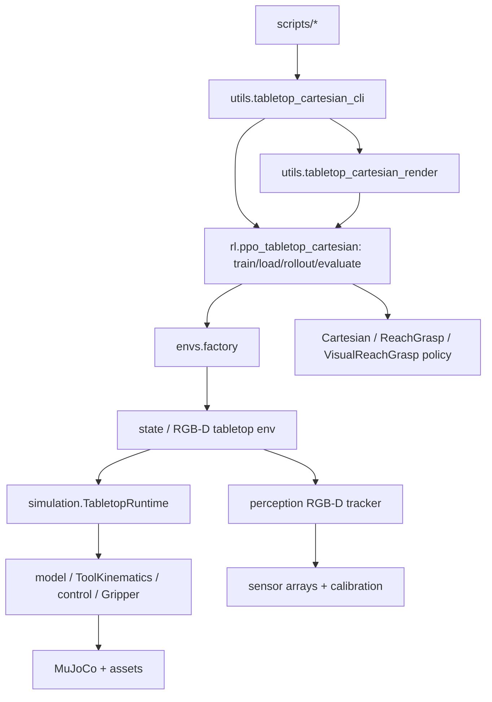

# 渐进式结构审计（2026-11-18）

分支 `refactor/project-reconstruct`；基线 `0e3496b67bc818aab2d1c1a49264d0be6e435215`。开始时工作区干净。实际扫描 src 70、scripts 42、tests 29，共 141 个 Python 文件，覆盖全部源码层。源码快照、完整导入图及类指纹保存在 `/tmp/realman-structure-refactor-20261118/`。

## 当前基线目录树

下图列出本次审计时实际存在的全部 Python 文件；assets、outputs、依赖和历史文档保留原状。

```text
├── scripts/
│   ├── demos/
│   │   ├── control_ee.py
│   │   ├── control_joints.py
│   │   ├── demo_gripper.py
│   │   ├── detect_tabletop_cube.py
│   │   ├── move_to_observation_pose.py
│   │   ├── render_ppo_tabletop.py
│   │   ├── render_ppo_tabletop_cartesian.py
│   │   ├── run_grasp_contact_cases.py
│   │   ├── run_grasp_lift.py
│   │   └── view_robot.py
│   ├── diagnostics/
│   │   ├── compare_controllers.py
│   │   ├── compare_fk.py
│   │   ├── compare_ik.py
│   │   ├── compare_sac_boundary.py
│   │   ├── diagnose_reach_rewards.py
│   │   ├── diagnose_sac_reach.py
│   │   ├── probe_ppo_goals.py
│   │   ├── probe_reach_env.py
│   │   └── smoke_reach_env.py
│   ├── evaluate/
│   │   ├── analyze_reach_results.py
│   │   ├── evaluate_bc_reach.py
│   │   ├── evaluate_ppo_grasp_lift.py
│   │   ├── evaluate_ppo_reach.py
│   │   ├── evaluate_ppo_tabletop.py
│   │   ├── evaluate_ppo_tabletop_cartesian.py
│   │   ├── evaluate_reach_baselines.py
│   │   └── evaluate_sac_reach.py
│   ├── models/
│   │   ├── build_dynamics_model.py
│   │   ├── build_grasp_scene.py
│   │   ├── build_gripper_model.py
│   │   ├── build_tabletop_cartesian_scene.py
│   │   ├── build_tabletop_scene.py
│   │   └── inspect_model.py
│   ├── plots/
│   │   ├── plot_ppo_training.py
│   │   └── plot_sac_training.py
│   └── train/
│       ├── collect_reach_demonstrations.py
│       ├── train_bc_reach.py
│       ├── train_ppo_grasp_lift.py
│       ├── train_ppo_reach.py
│       ├── train_ppo_tabletop.py
│       ├── train_ppo_tabletop_cartesian.py
│       └── train_sac_reach.py
├── src/
│   └── realman_rl_simtoreal/
│       ├── __init__.py
│       ├── envs/
│       │   ├── __init__.py
│       │   ├── factory.py
│       │   ├── grasp_lift_env.py
│       │   ├── reach_env.py
│       │   ├── sequence_reach_env.py
│       │   ├── tabletop_cartesian_env.py
│       │   ├── tabletop_cartesian_vision_env.py
│       │   └── tabletop_pick_env.py
│       ├── evaluation/
│       │   ├── __init__.py
│       │   ├── baselines.py
│       │   ├── grasp_lift.py
│       │   ├── metrics.py
│       │   └── reach.py
│       ├── imitation/
│       │   ├── __init__.py
│       │   ├── bc.py
│       │   └── bc_to_sac.py
│       ├── paths.py
│       ├── perception/
│       │   ├── __init__.py
│       │   └── rgbd.py
│       ├── rl/
│       │   ├── __init__.py
│       │   ├── cartesian_policy.py
│       │   ├── cartesian_reach_policy.py
│       │   ├── common/
│       │   │   ├── __init__.py
│       │   │   ├── artifacts.py
│       │   │   ├── env_factory.py
│       │   │   ├── logging.py
│       │   │   └── observation.py
│       │   ├── ppo.py
│       │   ├── ppo_grasp.py
│       │   ├── ppo_tabletop.py
│       │   ├── ppo_tabletop_cartesian.py
│       │   ├── sac.py
│       │   ├── sac_diagnostics.py
│       │   ├── sac_monitoring.py
│       │   └── vision_policy.py
│       ├── simulation/
│       │   ├── __init__.py
│       │   ├── camera.py
│       │   ├── cartesian_controller.py
│       │   ├── control.py
│       │   ├── ee_control.py
│       │   ├── grasp_contact.py
│       │   ├── grasp_controller.py
│       │   ├── grasp_metrics.py
│       │   ├── gripper.py
│       │   ├── kinematics.py
│       │   ├── model.py
│       │   ├── observation_pose.py
│       │   ├── observation_profiles.py
│       │   ├── rgbd_camera.py
│       │   ├── tabletop_runtime.py
│       │   └── tool_kinematics.py
│       ├── tasks/
│       │   ├── __init__.py
│       │   ├── grasp_lift.py
│       │   ├── reach.py
│       │   ├── rewards.py
│       │   ├── tabletop_cartesian.py
│       │   ├── tabletop_cartesian_reward.py
│       │   └── tabletop_pick.py
│       ├── utils/
│       │   ├── __init__.py
│       │   ├── artifacts.py
│       │   ├── demo_helpers.py
│       │   ├── geometry.py
│       │   ├── metrics.py
│       │   ├── tabletop_cartesian_cli.py
│       │   └── tabletop_cartesian_render.py
│       ├── vendor/
│       │   ├── __init__.py
│       │   ├── realman_fk.py
│       │   └── realman_ik.py
│       └── viewer.py
└── tests/
    ├── test_bc_reach.py
    ├── test_cartesian_learning.py
    ├── test_evaluation.py
    ├── test_fetch_observation.py
    ├── test_fk_comparison.py
    ├── test_goal_conditioned_reach.py
    ├── test_grasp_contact.py
    ├── test_grasp_lift.py
    ├── test_gravity_compensation.py
    ├── test_gripper.py
    ├── test_ik_comparison.py
    ├── test_joint_control.py
    ├── test_kinematics.py
    ├── test_package.py
    ├── test_ppo_grasp.py
    ├── test_ppo_random_reach.py
    ├── test_ppo_reach.py
    ├── test_pure_reach_training.py
    ├── test_reach_env.py
    ├── test_reach_progress_reward.py
    ├── test_reach_task.py
    ├── test_rgbd_vision.py
    ├── test_sac_bc_initialization.py
    ├── test_sac_diagnostics.py
    ├── test_sac_reach.py
    ├── test_sequence_reach.py
    ├── test_tabletop_cartesian.py
    ├── test_tabletop_pick.py
    └── test_wide_reach.py
```

## 调用关系与确认事实



全包静态导入图未发现循环（包括函数内 import）。环境与 simulation 不导入 RL；现有 Evaluation 也不依赖 PPO 实现。确认的职责混合集中于新增笛卡尔训练模块、utils 下的 CLI / 渲染文件，而不是全仓库普遍失去分层。

### 确认存在的重复实现

| 位置 | 证据 | 处理方向 |
|---|---|---|
| ppo.py / ppo_grasp.py 的 parameter_hashes | 归一化 AST 完全相同；actor/critic/all 与 log_std 前缀相同 | 提取共享权重指纹，原名称继续可导入 |
| ppo_grasp.py / ppo_tabletop_cartesian.py 的 optimizer_steps | AST 完全相同；其他 PPO helper 仅局部变量名不同 | 共享只读 Adam 步数工具 |
| rl/common/artifacts.py、ppo_tabletop_cartesian.py 的 JSON 写入 | 相同目录创建/缩进流程；ensure_ascii、allow_nan 默认值不同 | 统一底层文件操作，保留每个旧包装的序列化选项 |
| 多个来源工具里的文件 SHA256 | 都对原始文件字节做 SHA256，但文件集合/排序/键不同 | 共享单文件/文件集合 hash；来源范围及排序由原调用者决定 |
| 真值/视觉 observation 的夹爪速度和参考开口 | 相同 LINK_X/LINK_Z 导数与 encoder/ctrl 读取 | 复用 Gripper 状态读取，经轨迹回归后迁移最新 Runtime |

### 相似但语义不同，保留独立

- Reach、局部 GraspLift、七维关节桌面、四/七维笛卡尔桌面有不同 reset、TCP、动作、奖励和保护范围，不能合为一个任务。
- Cartesian actor_mean 指纹不包含 log_std；Reach/Grasp actor 指纹包含 log_std，不能因名称相似强行合并。
- 真值 observation 使用仿真物体/接触，视觉 observation 使用传感器估计和视觉保持，完成判断需接受独立物理验收；相同维度不代表同一契约。
- 原接触法向力与新 inward grasp forces 定义不同；视觉夹持置信度也不是接触力。
- 各来源记录有显式文件列表、全包 rglob、不同 runtime 版本字段，统一工具不能统一其历史定义。

## 架构建议（不是已确认的数值缺陷）

| 建议 | 原因 / 边界 |
|---|---|
| CLI / visualization 独立目录 | utils 存放可执行调度和图像生成不便定位；这是职责整理，不是已发现控制错误 |
| 笛卡尔评估放入 evaluation | 当前 rollout/evaluate 包含真实通用 Episode 循环；PPO 分布读取与 checkpoint 应留在 RL |
| 最小运行时状态接口 | 最新 Runtime 已复用 FK/IK/advance_synchronized_cycle；只补实际需要的状态读取，不建抽象基类，不迁全部历史环境 |
| 视觉观测采用纯函数组合 | 已有 Tracker 是组合；将只允许的传感器/本体字段显式传入编码器，避免把整个特权 info 传入 |
| 奖励/课程进入既有 tasks 模块 | 提取不改公式，RL 保留兼容名称；不同任务公式绝不合并 |

未发现值得为减少文件数量而合并的核心算法模块。camera.py 只有相机坐标基生成，但有 rgbd / runtime 两个实际调用者；ToolKinematics 只改刚性 TCP 选择，确实复用原解算器，应保留。旧 utils CLI/render 路径可作为历史兼容转发，不再保留两套实现。

## 保留的历史接口

- 所有 scripts/train、evaluate、demos 路径、参数、默认行为、退出码。
- 自定义 SB3 类：rl.cartesian_policy、rl.cartesian_reach_policy、rl.vision_policy 内全部类，及 ppo_tabletop.SmoothJointPolicy / CorrelatedPositionNoise；类路径、网络和 forward 全部冻结。
- 原 RL 模块的 save/load/evaluate/rollout/write_json、parameter_hashes、optimizer_steps 等公开函数名以真实实现或薄适配保留。
- 旧 PPO/SAC/BC 模型、配置、Replay、outputs 与验证报告。正常加载仍拒绝旧无契约模型，不自动猜测 / 升级观测。

## 六阶段修改计划与验证

1. 审计与当前文档：记录实际树、依赖、重复/语义差异和测试基线；独立提交。
2. 通用产物工具、CLI、visualization：复用 utils/artifacts，保留序列化差异 / 来源集合；旧入口薄转发；用 JSON 字节、ZIP 成员、原 CLI 和 checkpoint 测试验证。
3. evaluation/tabletop_cartesian：移走环境回合/汇总，只通过预测/状态指纹回调适配 PPO；固定/随机、真值/视觉逐动作与物理状态对照。
4. Runtime：先公开已有只读状态和夹爪速度，优先最新 Runtime；advance / 接触 observer / FK/IK 不改，50×1ms、限幅和安全路径冻结。
5. 视觉：显式组合纯观测/进度计算，保留相机、Tracker、继承生命周期和完成审计时序；poison privileged info / lost target / 原模型 RGB-D 对照。
6. 任务定义：原奖励/课程表达式逐字提取到现有 tasks，RL 名称兼容；新旧公式与模型状态逐项回归，完整套件复验。

每阶段先运行对应检查再创建独立 commit。文件权限不足时仅对必要 Git 索引写入请求沙箱外执行；不创建额外 worktree，不切换 main，不 push。

## 风险与停止条件

策略类/网络、模型文件、MuJoCo 时间步或物理 observer 调用顺序不在授权修改范围。任何对照不能通过的迁移留在原实现，不通过放宽断言或仅比较最终成功率解决。

基线和最终完整 unittest；阶段专项；真实模型固定种子下逐步比较动作、qpos/qvel、TCP/夹爪/物体、接触、IK 接受比例、原因、奖励。确定性 CPU 数组优先逐元素相等，若需要容差必须记录明确 atol/rtol 与原因。来源 hash 的规则/范围保持；源码变动后新记录的实际 hash 值自然更新。

## 阶段 1：基线与审计完成

环境：Conda `realman_rl` / Python 3.11.17，MuJoCo 3.17.0，Gymnasium 1.4.0，NumPy 2.4.6，PyTorch 2.14.0+cpu，SB3 2.9.2。全量源码审计覆盖 141 个 Python 文件；静态导入无环。没有修改代码、模型、实验数据或物理资源。

实际命令（均使用该 Conda 环境的 Python）：

```bash
python -I -m unittest discover -s tests -v
MUJOCO_GL=egl python -I -m unittest discover -s tests -v
```

默认显示后端：Ran 501 tests / 674.459 s，0 断言失败、1 个 `VisualPhysicsTests.setUpClass` 错误、0 跳过；Wayland 无法连接，OpenGL context 未创建，该类 5 个视觉物理用例未执行。EGL 无界面重跑：**506 项全部通过，0 失败、0 错误、0 跳过，663.834 s**。这是修改任何源码前的完整基线，不通过调整测试断言绕过显示错误。

七类历史模型已实际只读加载：Reach PPO、SAC、BC、局部 GraspLift PPO、关节桌面 PPO、真值笛卡尔 PPO、RGB-D 视觉 PPO；记录了固定输入的 raw/applied 动作、完整参数、优化器状态、训练计数和文件 SHA256。自定义策略的 8 个类的路径 / AST 已冻结。模型加载未执行参数更新。

真值 / 视觉各一组固定与半径 0.02 m 随机位置基准：seed 850000 / 870000 / 910000 / 920000；分别 1290 / 1297 / 1513 / 1475 个策略步，87950 / 88300 / 99100 / 97200 个 1 ms 物理步，均 success。记录每个物理步的 qpos / qvel / ctrl / actuator force，以及每个策略步的 TCP 位姿、夹爪开口、接触、动作接受比例、奖励、完整 info、观测和 RGB-D 帧摘要，供后续逐元素对照。权重、优化器和计数均保持不变。以上为本轮真实执行结果，不引用历史成功率代替新验证。

变更文件：本审计、architecture.md、FILE_MAP.md、README.md。文件地图现在列出实际全部 Python 文件和静态调用者；历史报告原样保留。此阶段只修正文档与现状不一致的问题，没有移动任务或合并算法。

## 阶段 2：公共产物工具与入口职责

- `utils/artifacts.py` 成为 JSON / JSONL、单文件与调用者指定集合的 SHA256、依赖版本、ZIP 快照、空输出目录检查的唯一文件操作实现。`rl/common/artifacts.py` 保留原导入接口和 Reach 的原来源文件集合。Cartesian、GraspLift、关节桌面的来源范围 / 排序 / 路径键不变；新实验按当前源码计算真实指纹，旧实验不改写。
- 完全相同的 `parameter_hashes`、Adam `optimizer_steps` 进入 `rl/common/artifacts.py`；原 PPO / Grasp / Cartesian 名称继续可导入。Cartesian 的 actor_mean 排除 log_std 的不同定义保留。所有模型保存 / 加载留在算法模块。
- 笛卡尔解析实现进入 `cli/tabletop_cartesian.py`，回放实现进入 `visualization/tabletop_cartesian.py`，原 utils 两个路径仅转发公开名称；原四个 scripts 路径及所有参数不变。没有把单个调用者的离线分析脚本抽成框架。
- 新增 `tests/test_refactor_contracts.py` 和基线 fixture：测试原 JSON 字节 / NaN 规则、ZIP 内容 / 成员顺序、来源选择、不可覆盖目录、共享 helper、全量旧 CLI 参数 AST、旧导入转发、24 组奖励基准、8 个策略类及关键物理 / 完成方法冻结，以及 7 类旧模型只读加载 / 推理。扩充 package 测试，覆盖新轻量包和四个旧 CLI help。

验证：`MUJOCO_GL=egl python -I -m unittest discover -s tests -p test_refactor_contracts.py -v`：12 / 12 通过，0 失败 / 错误 / 跳过；同样命令 `-p test_package.py`：10 / 10 通过，0 失败 / 错误 / 跳过。七类模型固定输入的 raw / applied 动作、完整权重和优化器摘要均与修改前逐位相同；没有训练。变更文件为上述公共工具、4 个 PPO 模块、两个新包及旧兼容模块、4 个脚本、2 个测试与 fixture、架构 / 文件地图 / 本报告。

## 阶段 3：笛卡尔训练与独立评估解耦

`evaluation/tabletop_cartesian.py` 接收未裁剪动作的 predict callable、action_shape、可选 state_fingerprint / sources 回调，承担原 rollout / evaluate 的独立环境、指定 seed、终止、full / radius 配置和原 JSON 汇总。它可由规则、PPO、SAC 或 BC 的适配器调用，不导入 Torch / SB3 / 算法模块。PPO 的 checkpoint 和原 get_distribution(... deterministic=True) 保留在 `rl/ppo_tabletop_cartesian.py`，旧 evaluate / rollout 为薄适配。沿用原 phase / tick 的 ppo 标签以保持输出兼容；不改动作。

消除的是混合职责及未来重复循环的必要性，未把不同任务强行合并。GraspLift / 关节桌面原本已经复用抓取评估器，本阶段不额外拆分它们。模型 guard 在原参数 / step / epoch 检查之上补充 Adam 动量、参数组指纹；未提供状态回调的新通用调用明确返回 null，旧 PPO JSON 仍为 true。

实际测试（均 `MUJOCO_GL=egl python -I -m unittest discover -s tests ... -v`）：`-p test_tabletop_evaluation.py` 7 项、`-p test_tabletop_cartesian.py` 28 项、`-p test_refactor_contracts.py` 12 项、`-p test_package.py` 10 项，合计 **57 通过，0 失败 / 错误 / 跳过**。测试包括外部环境所有权、异常关闭、完整 JSON 键、raw / clipped 动作、视觉 pre-action 观测、仅优化器动量变化的反例、原随机化覆盖顺序、真实短 PPO 更新与旧模型加载。原断言未放宽；只将环境 / rollout mock 目标改为新的实际实现位置，并补全假优化器的 state_dict 接口。

另实际执行真值旧模型 seed 850000 / 870000 两个完整回合，分别 1290 / 1297 策略步、87950 / 88300 物理步。与修改前记录相比，physics、states、observations、raw_actions、actions 最大绝对差均 **0**；比较容差为物理 / 观测 `atol=1e-12, rtol=0`、动作 `atol=0, rtol=0`。完整任务结果 / 每步 JSON（除当前源码 sources）逐字段相同。权重、完整优化器和训练计数不变。独立 `python -I -c` 验证只导入新评估器不会加载 Torch 或 SB3。

变更：新评估器、新评估接口测试、PPO 薄适配、common 中 optimizer_state_hash、原 Cartesian 测试 mock、架构 / 文件地图 / 本报告。

## 阶段 4：最小 Runtime 接口与局部迁移

保留既有 TabletopRuntime，不新建平行机器人类。新增 get_joint_state（位置、速度、实际参考的独立副本）与 get_gripper_state（开口、速度），复用原 Gripper；同一夹爪导数公式提取为 Gripper.get_velocity，原 absolute-jaw 参考换算提取为 get_reference_width。最新真值 / 视觉环境及 CartesianController 改用这些读取，原数据字段 / 单位不变。

避免了一个潜在行为改变：视觉观测不需要实际参考角度的验证，因此 measured gripper state 不额外转换 / 验证 ctrl；get_reference_width 仅在原本进行该换算的真值 absolute 路径使用。没有改变 FK / IK 算法、controller 回溯、Runtime.advance / prepare / reset_zero / 安全方法或环境 step / hold 方法。没有提取奖励、视觉检测或成功条件到 Runtime。

最小接口设计及单位、所有权见 architecture.md。旧 Reach 的 TCP / 25×2ms、本地抓取保护和关节桌面动作语义不同，未强制迁移；它们本来已经复用 model / kinematics / control / gripper。这个阶段解决已确认重复的状态读取与夹爪速度公式，不声称所有任务初始化都可等价合并。

实际测试：同前述 discover 命令，`-p test_tabletop_runtime.py` 3 项；`-p test_tabletop_cartesian.py -k CartesianPhysicsTests -k FixedObservationTests -k PoseControlTests` 18 项；`-p test_refactor_contracts.py` 12 项，合计 **33 通过，0 失败 / 错误 / 跳过**。覆盖副本不改变 live qpos / qvel / ctrl、请求宽度与实际参考的区别、50 次 1ms observer、真实夹持与保持、IK/Jacobian、位置 / 姿态动作及 7 类模型兼容。

旧真值模型两个完整 seed 850000 / 870000 再次执行，逐物理步 / 策略步所有数组最大差 **0**，完整结果 / 每步 JSON（sources 除外）相同，优化器 / 参数 / 计数不变。改动文件：Runtime、Gripper、CartesianController、两个最新环境、新 Runtime 测试与文档。
