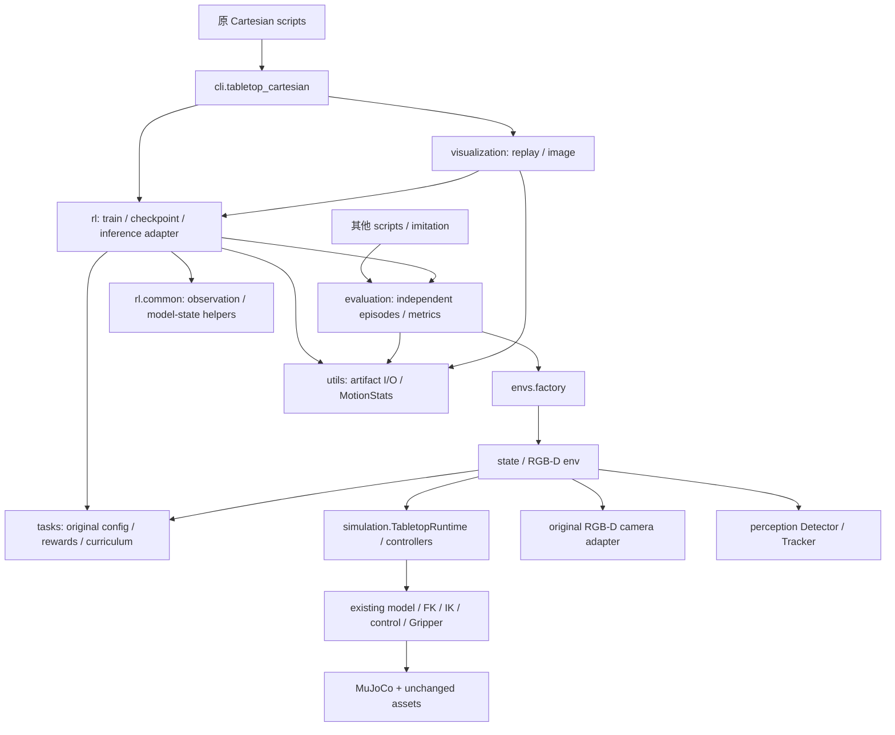

# 渐进式结构重构验证（2026-11-18）

## 范围与结论

在已有专用分支 `refactor/project-reconstruct` 实施；未切换 main、未创建额外 worktree、未 push。起点 `0e3496b67bc818aab2d1c1a49264d0be6e435215` 工作区干净。按六阶段逐一验证、分别提交。没有升级依赖、改模型 / 物理资源或正式长训练。

本轮抽出了确实重复的产物操作、模型状态 helper、夹爪速度读取；将现有桌面评估循环改成算法无关实现，明确 CLI / 回放、任务奖励与 RL 的边界。没有合并动作、奖励或成功语义不同的任务，也没有迁移自定义 SB3 类。

基线全目录、确认问题与建议的区别、逐阶段原始记录见 [STRUCTURE_AUDIT.md](STRUCTURE_AUDIT.md)。全部当前文件和调用者见 [FILE_MAP.md](../FILE_MAP.md)，现行约定见 [architecture.md](../architecture.md)。以下新验证不替代历史实验的泛化结论。

## 目录：修改前与修改后

基线核心包 70、脚本 42、测试 29，共 141 个 Python 文件。完整基线树见审计报告；涉及变化的部分如下：

```text
src/realman_rl_simtoreal/
├── rl/common/artifacts.py                 # 文件操作与模型 / Reach 来源混在一起
├── rl/{ppo,ppo_grasp,ppo_tabletop}.py      # 重复状态 helper；后两者含原任务奖励
├── rl/ppo_tabletop_cartesian.py           # 训练 / checkpoint / rollout / evaluate / 来源工具
├── evaluation/{reach,grasp_lift,metrics,baselines}.py
├── utils/{artifacts,tabletop_cartesian_cli,tabletop_cartesian_render}.py
├── envs/{tabletop_cartesian_env,tabletop_cartesian_vision_env}.py
├── tasks/{grasp_lift,tabletop_pick,tabletop_cartesian,tabletop_cartesian_reward}.py
└── simulation/{tabletop_runtime,gripper,cartesian_controller,...}.py
```

当前核心包 75、脚本 42、tests 下 33 个 Python 文件，共 150。33 个测试文件中包含 1 个显式手动运行的轨迹回归工具；它不参与自动 discover。完整代码树如下，assets / outputs / 历史报告保持原状：

```text
├── scripts/
│   ├── demos/
│   │   ├── control_ee.py
│   │   ├── control_joints.py
│   │   ├── demo_gripper.py
│   │   ├── detect_tabletop_cube.py
│   │   ├── move_to_observation_pose.py
│   │   ├── render_ppo_tabletop.py
│   │   ├── render_ppo_tabletop_cartesian.py
│   │   ├── run_grasp_contact_cases.py
│   │   ├── run_grasp_lift.py
│   │   └── view_robot.py
│   ├── diagnostics/
│   │   ├── compare_controllers.py
│   │   ├── compare_fk.py
│   │   ├── compare_ik.py
│   │   ├── compare_sac_boundary.py
│   │   ├── diagnose_reach_rewards.py
│   │   ├── diagnose_sac_reach.py
│   │   ├── probe_ppo_goals.py
│   │   ├── probe_reach_env.py
│   │   └── smoke_reach_env.py
│   ├── evaluate/
│   │   ├── analyze_reach_results.py
│   │   ├── evaluate_bc_reach.py
│   │   ├── evaluate_ppo_grasp_lift.py
│   │   ├── evaluate_ppo_reach.py
│   │   ├── evaluate_ppo_tabletop.py
│   │   ├── evaluate_ppo_tabletop_cartesian.py
│   │   ├── evaluate_reach_baselines.py
│   │   └── evaluate_sac_reach.py
│   ├── models/
│   │   ├── build_dynamics_model.py
│   │   ├── build_grasp_scene.py
│   │   ├── build_gripper_model.py
│   │   ├── build_tabletop_cartesian_scene.py
│   │   ├── build_tabletop_scene.py
│   │   └── inspect_model.py
│   ├── plots/
│   │   ├── plot_ppo_training.py
│   │   └── plot_sac_training.py
│   └── train/
│       ├── collect_reach_demonstrations.py
│       ├── train_bc_reach.py
│       ├── train_ppo_grasp_lift.py
│       ├── train_ppo_reach.py
│       ├── train_ppo_tabletop.py
│       ├── train_ppo_tabletop_cartesian.py
│       └── train_sac_reach.py
├── src/
│   └── realman_rl_simtoreal/
│       ├── __init__.py
│       ├── cli/
│       │   ├── __init__.py
│       │   └── tabletop_cartesian.py
│       ├── envs/
│       │   ├── __init__.py
│       │   ├── factory.py
│       │   ├── grasp_lift_env.py
│       │   ├── reach_env.py
│       │   ├── sequence_reach_env.py
│       │   ├── tabletop_cartesian_env.py
│       │   ├── tabletop_cartesian_vision_env.py
│       │   └── tabletop_pick_env.py
│       ├── evaluation/
│       │   ├── __init__.py
│       │   ├── baselines.py
│       │   ├── grasp_lift.py
│       │   ├── metrics.py
│       │   ├── reach.py
│       │   └── tabletop_cartesian.py
│       ├── imitation/
│       │   ├── __init__.py
│       │   ├── bc.py
│       │   └── bc_to_sac.py
│       ├── paths.py
│       ├── perception/
│       │   ├── __init__.py
│       │   └── rgbd.py
│       ├── rl/
│       │   ├── __init__.py
│       │   ├── cartesian_policy.py
│       │   ├── cartesian_reach_policy.py
│       │   ├── common/
│       │   │   ├── __init__.py
│       │   │   ├── artifacts.py
│       │   │   ├── env_factory.py
│       │   │   ├── logging.py
│       │   │   └── observation.py
│       │   ├── ppo.py
│       │   ├── ppo_grasp.py
│       │   ├── ppo_tabletop.py
│       │   ├── ppo_tabletop_cartesian.py
│       │   ├── sac.py
│       │   ├── sac_diagnostics.py
│       │   ├── sac_monitoring.py
│       │   └── vision_policy.py
│       ├── simulation/
│       │   ├── __init__.py
│       │   ├── camera.py
│       │   ├── cartesian_controller.py
│       │   ├── control.py
│       │   ├── ee_control.py
│       │   ├── grasp_contact.py
│       │   ├── grasp_controller.py
│       │   ├── grasp_metrics.py
│       │   ├── gripper.py
│       │   ├── kinematics.py
│       │   ├── model.py
│       │   ├── observation_pose.py
│       │   ├── observation_profiles.py
│       │   ├── rgbd_camera.py
│       │   ├── tabletop_runtime.py
│       │   └── tool_kinematics.py
│       ├── tasks/
│       │   ├── __init__.py
│       │   ├── grasp_lift.py
│       │   ├── reach.py
│       │   ├── rewards.py
│       │   ├── tabletop_cartesian.py
│       │   ├── tabletop_cartesian_reward.py
│       │   └── tabletop_pick.py
│       ├── utils/
│       │   ├── __init__.py
│       │   ├── artifacts.py
│       │   ├── demo_helpers.py
│       │   ├── geometry.py
│       │   ├── metrics.py
│       │   ├── tabletop_cartesian_cli.py
│       │   └── tabletop_cartesian_render.py
│       ├── vendor/
│       │   ├── __init__.py
│       │   ├── realman_fk.py
│       │   └── realman_ik.py
│       ├── viewer.py
│       └── visualization/
│           ├── __init__.py
│           └── tabletop_cartesian.py
└── tests/
    ├── manual_structure_regression.py
    ├── test_bc_reach.py
    ├── test_cartesian_learning.py
    ├── test_evaluation.py
    ├── test_fetch_observation.py
    ├── test_fk_comparison.py
    ├── test_goal_conditioned_reach.py
    ├── test_grasp_contact.py
    ├── test_grasp_lift.py
    ├── test_gravity_compensation.py
    ├── test_gripper.py
    ├── test_ik_comparison.py
    ├── test_joint_control.py
    ├── test_kinematics.py
    ├── test_package.py
    ├── test_ppo_grasp.py
    ├── test_ppo_random_reach.py
    ├── test_ppo_reach.py
    ├── test_pure_reach_training.py
    ├── test_reach_env.py
    ├── test_reach_progress_reward.py
    ├── test_reach_task.py
    ├── test_refactor_contracts.py
    ├── test_rgbd_vision.py
    ├── test_sac_bc_initialization.py
    ├── test_sac_diagnostics.py
    ├── test_sac_reach.py
    ├── test_sequence_reach.py
    ├── test_tabletop_cartesian.py
    ├── test_tabletop_evaluation.py
    ├── test_tabletop_pick.py
    ├── test_tabletop_runtime.py
    └── test_wide_reach.py
```

文件增加来自两个轻量包、一个实际复用的评估器和必要验证，不以减少文件数量替代职责整理。

## 已确认重复与实际处理

- `ppo.parameter_hashes` / `ppo_grasp.parameter_hashes` 完全相同，合为 `rl.common.artifacts.parameter_hashes`；三个 PPO 的 Adam step 读取也共用。旧名称继续导出。Cartesian actor_mean 不含 log_std，保留其不同定义。
- JSON / JSONL、字节 SHA256、版本与 ZIP 文件操作复用 `utils.artifacts`。strict JSON 保持 ensure_ascii=True / allow_nan=False；Cartesian 保持 ensure_ascii=False / allow_nan=True；回放和历史 JSONL 保留各自原选项。
- 来源文件选择、排序、路径键仍由原实验定义。Reach 的未排序 rglob、抓取的显式来源列表、Cartesian 全包 rglob 与快照选择不被混成一套。新源码自然有新的实际指纹，历史来源记录未改写。
- 真值 / 视觉环境的夹爪开口速度导数提取至 `Gripper.get_velocity()`，实际参考换算复用 `get_reference_width()`；只在原本需要该校验的路径调用。
- 关节桌面不再仅为读取参数 / Adam 状态而导入另一个 PPO 任务。CLI 与回放的迁移属于职责修正，不被算作重复算法的消除。
- Reach、本地 GraspLift、关节桌面、笛卡尔桌面及真值 / 视觉契约的差异保留；接触法向力、inward force 和视觉置信度也不合并。

## 文件 / 主要实现迁移表

路径均相对 `src/realman_rl_simtoreal/`；注明函数时为部分提取，原文件保留其自身职责。

| 原位置 | 实际位置 | 兼容性 |
|---|---|---|
| utils/tabletop_cartesian_cli.py | cli/tabletop_cartesian.py | 原 main 导入转发；四个 scripts 路径 / 参数不变 |
| utils/tabletop_cartesian_render.py | visualization/tabletop_cartesian.py | 原 Recorder / run 导入转发 |
| rl/common/artifacts.py 的文件操作 | utils/artifacts.py | 原名称重导出；Reach 来源集合保留 |
| PPO / Grasp 重复 parameter_hashes、Adam steps | rl/common/artifacts.py | 原公开名称指向同一实现 |
| rl/ppo_tabletop_cartesian.py 的 rollout / evaluate 循环 | evaluation/tabletop_cartesian.py | RL 原签名为确定性推理薄适配 |
| rl/ppo_grasp.py 的奖励 / 课程 / 纯奖励函数 | tasks/grasp_lift.py | 原名称与默认对象兼容导出 |
| rl/ppo_tabletop.py 的奖励 / 课程 / 纯奖励函数 | tasks/tabletop_pick.py | SmoothJointPolicy 与分布类仍留原模块 |
| rl/ppo_tabletop_cartesian.py 的 EASY / STAGES | tasks/tabletop_cartesian.py | RL 原名称继续导出 |
| 两个最新环境的夹爪速度式 | simulation/gripper.py | 原公式 / 单位 / 精度一致 |
| 视觉 _observation 中进度 / 编码 | 同一视觉环境模块的两个纯函数 | Camera / Tracker / step / reset / 独立物理验收不变 |

## 公共接口与调用者

- `utils.artifacts`：rl.common 兼容导出、PPO / BC 及实验入口、Cartesian 来源与回放使用。文件集合属于调用者，模型 save / load 仍由算法拥有。
- `rl.common.artifacts.parameter_hashes / optimizer_steps / optimizer_state_hash`：Reach / 抓取 / 桌面薄适配与训练审计；optimizer_state_hash 额外保护 Adam 动量与参数组。
- `cli.tabletop_cartesian.main`：原 train / evaluate / render / setup 四个脚本；原 utils 名称只转发。没有四份解析器。
- `visualization.tabletop_cartesian.Recorder / run`：由共享 CLI 调度；保留原 MuJoCo 三视图、RGB-D debug 与 GIF 输出。
- `evaluation.tabletop_cartesian.rollout(env, predict, seed, tick=None)`：接收确定性的未裁剪动作函数，执行原 seed / clip / float32 / termination / records 协议。
- `evaluation.tabletop_cartesian.evaluate(predict, config, seeds, action_shape=..., state_fingerprint=..., sources=...)`：独立环境与 full / radius 覆盖、Episode 汇总。RL / CLI / render 经薄适配复用；其他算法可提供自己的 predict / fingerprint，不需导入 PPO。
- `TabletopRuntime.get_joint_state()`：最新环境 info 与 CartesianController；副本含 SI 位置 / 速度 / 实际参考。`get_gripper_state()`：视觉本体观测，含实际开口 / 速度。现有 prepare / tcp_pose / kinematics.solve_ik / advance / forces 继续复用。
- `visual_grip_and_hold / encode_visual_observation`：由视觉环境组合使用，显式接收允许的传感器 / 本体字段，不传整个特权 info。保持单模块纯函数，不添加仅一个实现的抽象类。
- `tasks.grasp_lift / tabletop_pick` 的原 reward / curriculum：由原 RL 包装使用；其他算法现在可直接使用任务计算而不导入 PPO。13 个迁移定义（含 Cartesian 门槛）与原 AST 完全相同。

Reach 的 `evaluation.reach` 与 GraspLift 的 `evaluation.grasp_lift` 仍提供原协议；SAC、BC 和规则共用原 Reach 接口。`utils.metrics.MotionStats` 保留为训练 / 评估中立统计。SAC Q/TD、Replay、PPO 训练 Audit 与训练参数更新仍在 RL。tests 核对实现是否正确，evaluation 衡量给定策略在任务中的行为；scripts 只处理运行入口。

## 当前关键依赖



75 个核心模块的静态图无循环；envs / tasks / simulation 不导入 evaluation 或算法。Evaluation 不导入 Torch / SB3 / PPO / SAC / BC；Reach 仅复用不依赖算法的 rl.common.observation 契约。完整静态边与核验摘要存于 [机器可读证据](STRUCTURE_REFACTOR_EVIDENCE.json)。

## 六阶段与提交

1. `4f1f755` 审计与文档：全仓结构 / 来源冻结、506 项 EGL 基线；不改代码。
2. `42319b0` 公共产物 / CLI / 回放：12 项契约 + 10 项包测试；7 类历史模型固定输入推理一致。
3. `bf52c66` 桌面独立评估：7 + 28 + 12 + 10 = 57 项通过；真值两回合逐步最大差 0。
4. `acff7a5` Runtime 局部迁移：3 + 18 + 12 = 33 项通过；真值两回合再次最大差 0；原 50×1ms / observer / FK/IK 不动。
5. `1ea3047` 视觉有限组合：14 + 17 = 31 项通过；视觉两回合逐步 / 帧摘要一致；保留原完成审计。
6. 本报告所在提交：原任务奖励 / 课程迁移、公共 SHA 使用收尾、去除 helper 的跨算法导入、最终全套 / 模型 / 文件完整性验证。16 项契约先通过；没有把不同奖励合并。

每阶段变更文件 / 测试细节见审计中对应小节，或 `git show --stat <commit>`。第六阶段同时补全旧 CLI 自动发现（全部 37 个可解析入口）、修正文档里“视觉未实现”“权重迁移未实现”等早期描述；历史验证报告和成绩原样保留。

## 实际测试结果

完整 EGL 基线：**506 通过、0 失败、0 错误、0 跳过，663.834 s**。最终全量：**532 通过、0 失败、0 错误、0 跳过，677.284 s**。额外扩充 CLI 扫描后的 package 套件 10 / 10 通过（37 条 --help 全部成功，另含包、分层、退出码和 Viewer 检查）。

实际命令（仓库根目录，Conda realman_rl）：

```bash
python -I -m unittest discover -s tests -v
MUJOCO_GL=egl python -I -m unittest discover -s tests -v
MUJOCO_GL=egl python -I -m unittest discover -s tests -p test_refactor_contracts.py -v
MUJOCO_GL=egl python -I -m unittest discover -s tests -p test_tabletop_evaluation.py -v
MUJOCO_GL=egl python -I -m unittest discover -s tests -p test_tabletop_cartesian.py -v
MUJOCO_GL=egl python -I -m unittest discover -s tests -p test_tabletop_runtime.py -v
MUJOCO_GL=egl python -I -m unittest discover -s tests -p test_rgbd_vision.py -v
MUJOCO_GL=egl python -I -m unittest discover -s tests -p test_package.py -v
MUJOCO_GL=egl python -I tests/manual_structure_regression.py --json /tmp/realman-structure-regression-new.json
```

最初默认显示后端跑了 501 个方法，0 断言失败、1 个 VisualPhysicsTests.setUpClass 错误，5 个视觉物理方法未执行：Wayland 无法连接，OpenGL context 未建立。随后源码未修改即以 EGL 完整重跑 506 / 506，通过；这不是通过跳过或放宽测试处理回归。最终全量同样使用 EGL。

所有阶段专项均 0 失败 / 错误 / 跳过。全量覆盖 FK / IK、关节和末端轨迹、重力补偿、夹爪 / 接触、Gymnasium 空间、PPO / SAC / BC、BC 数据与 BC→SAC、Reach→Grasp 权重迁移、视觉 PPO、真值隔离和优化器只读保护。既有小规模 32 / 64 / 512 步训练更新属于原单元测试；没有启动正式训练 run。

### 四个旧模型回合的数值对照

| 模式 | seed | 策略步 | 1 ms 物理步 | 结果 |
|---|---:|---:|---:|---|
| 真值固定 | 850000 | 1290 | 87950 | success；逐元素 / JSON 相同 |
| 真值半径 0.02 m 随机 | 870000 | 1297 | 88300 | success；逐元素 / JSON 相同 |
| RGB-D 固定 | 910000 | 1513 | 99100 | success；逐元素 / JSON / 帧相同 |
| RGB-D 半径 0.02 m 随机 | 920000 | 1475 | 97200 | success；逐元素 / JSON / 帧相同 |

共 5575 个策略步、372550 个物理步。每物理步比较 time / qpos / qvel / ctrl / qfrc_actuator；每策略步比较 TCP 位置 / 姿态、夹爪、物体、inward / raw 接触统计、IK 接受比例、观测、raw / applied 动作、每步奖励、总回报、安全 / 终止原因、完整 records。视觉同时比较每帧 RGB 与米制深度摘要及时间戳。

阶段比较使用 `rtol=0`，物理 / 观测 `atol=1e-12`、动作 `atol=0`，实际最大差全部 0。最终手动工具用修改前记录的 dtype / shape / 原始数组字节 SHA 及规范化 JSON / 帧摘要进行更严格的逐位核验，四组全部一致。源码 sources 随当前代码变化而排除数值相等比较，其原选择 / 排序 / SHA 定义有独立契约测试。

权重、完整 Adam 状态、参数组及训练计数在评估前后相同。此结果证明这四条固定种子轨迹的数值等价，不是新增的泛化成功率估计。手动工具不会自动进入 unittest discover；可通过 --cases 选择子集，缺少模型会明确失败，不会虚构结果。基准摘要已持久保存于 tests/fixtures/refactor_contracts.json，不依赖临时原始轨迹文件；不允许通过重录预期值掩盖回归。

## 已有 checkpoint 的只读兼容性

下表七类模型均实际存在并完成加载；固定输入的网络 raw / applied 动作、完整权重与优化器摘要与重构前相同。路径相对仓库根。自动契约测试在模型不在本地时明确 skip，本次 **0 skip**。

| 类别 | 实际 checkpoint | 本轮验证 |
|---|---|---|
| Reach PPO | `outputs/reach/ppo/random_goal_relative_seed2026/final/model.zip` | 加载 / raw 与 applied 动作 / 权重与优化器一致 |
| SAC | `outputs/reach/sac/formal_seed2026/final/model.zip` | 加载 / raw 与 applied 动作 / 权重与优化器一致 |
| BC | `outputs/imitation/bc/fit_seed2026/best_bc.pt` | 加载 / raw 与 applied 动作 / 权重与优化器一致 |
| GraspLift PPO | `outputs/grasp/ppo/precision_goal_seed2027/final/model.zip` | 加载 / raw 与 applied 动作 / 权重与优化器一致 |
| 关节桌面 PPO | `outputs/grasp/ppo/tabletop_unfold25_explore_seed2027/checkpoints/step_00016384/model.zip` | 加载 / raw 与 applied 动作 / 权重与优化器一致 |
| 真值笛卡尔 PPO | `outputs/grasp/ppo/tabletop_cartesian/fixed_observation_v2/full_table_down_seed2029_r13_secure_grip/checkpoints/step_00003072/model.zip` | 加载 / raw 与 applied 动作 / 权重与优化器一致 |
| RGB-D 视觉 PPO | `outputs/grasp/ppo/tabletop_cartesian/vision_rgbd_v1/full_table_down_seed2031_r4_zero_anchored/checkpoints/step_00000768/model.zip` | 加载 / raw 与 applied 动作 / 权重与优化器一致 |

全部 checkpoint 文件 SHA256 与相邻配置原样保留。自定义策略 / 分布 / 特征共 9 个类经基线 AST 对照相同，其中 8 个策略 / 特征类由自动契约测试冻结，CorrelatedPositionNoise 另做同样静态对照。13 个任务定义与原 AST 相同，24 组奖励 / 组件 / 历史分支数值完全一致；16 个关键仿真 / 原环境 / 相机 / 感知 / Policy 源文件全文保持。详情和模型指纹见机器可读证据。

只读推理不能替代所有模型的闭环性能复测。除四条真值 / 视觉轨迹外，没有声称重新跑过历史 20 / 1000 回合成功率；没有修改旧 JSON、checkpoint 格式、网络参数更新、相机契约或原 CLI 参数。

## 数据完整性与保留接口

原有 **11120 个受保护文件 / 6189603051 字节**逐文件 SHA256 复核：0 改写、0 丢失，涵盖 outputs、assets、vendor、perception、原 tests/fixtures。受保护范围仅增加本轮新 fixture；outputs 没有新增、删除或覆盖文件。

原 scripts 路径、所有 argparse 参数 / 默认值 / 互斥条件、退出语义保留。PPO / SAC / BC loader、旧 RL helper 名称、原 utils CLI / render 名称仍可导入。训练 / 评估的来源集合和统计口径不变；JSON 原字段和物理含义不变。正常 loader 对无契约旧模型的拒绝仍保留，不猜测缺失 config，不重写旧模型。

## 保留项、限制与后续组织规则

- Reach、局部抓取、关节桌面还保留各自初始化 / 生命周期：TCP、控制周期、动作 / 保护不同，缺少逐任务等价证据时不强制接入一个 Runtime。最新 Runtime 只做已证实等价的状态读取迁移。
- 视觉仍继承原物理环境。此次组合的是允许输入的进度 / 编码函数，完整替换继承、完成调度或物理验收尚未证明收益 / 等价，故保留原方法。
- 历史训练入口的局部非空目录前置检查保留不同消息与校验 / 创建时机，不能简单替换为立即建目录的 helper；公共空目录工具已在原共享调用链复用。
- 来源定义、动作 / 奖励 / 接触含义不同的相似代码继续独立。网络 / optimizer / Replay 专用逻辑不移入 Evaluation，也不为单个调用者新增抽象框架。
- 没有遍历加载所有历史 checkpoint；无配置、旧 startup / force / vision 契约的已知限制未擅自升级。未做长训练或真机 / 真实深度噪声性能验证；普通 wheel 的 assets 打包也仍是既有边界。
- 后续新增算法先复用任务定义与 Evaluation 的 predict / fingerprint 接口；只读适配留在算法模块，避免复制 Episode 循环。
- 新增控制能力先查 model / kinematics / control / gripper / Runtime，保留 SI 单位与明确步进时序；任务奖励、目标检测不进入底层执行器。
- 新观测必须显式定义输入契约，视觉不读物体真值；模型类路径是序列化 ABI，迁移须有旧 checkpoint 回归方案。
- 修改公共代码时保留调用者来源范围 / JSON 选项；新增实验用新目录，不能改写历史来源或模型。先提供固定种子、逐步状态和明确容差的回归，再扩大迁移范围。

本报告、审计、架构和文件地图构成当前结构说明；旧实验报告保留其当时版本含义。
